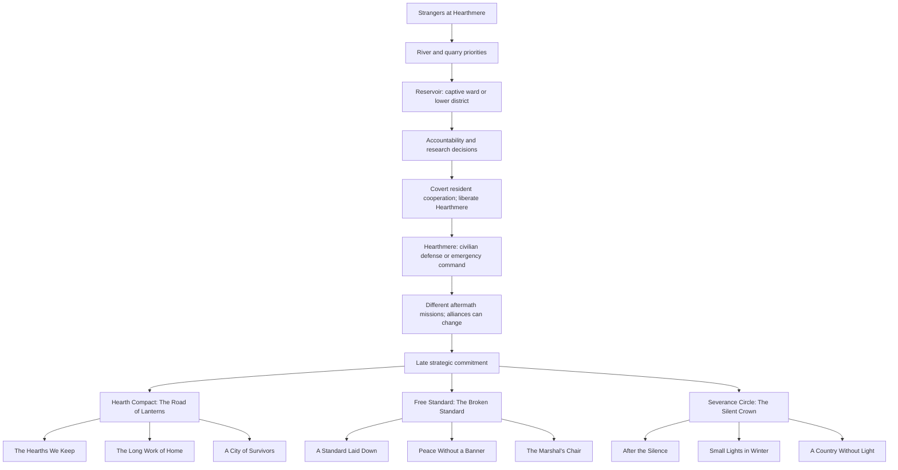
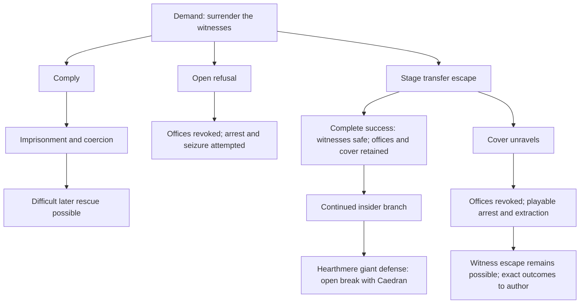

# The Starforged Crown — branching campaign draft

November 4, 2026. The user selected this as the next writing focus. This is newly proposed story content built around the confirmed requirements, not a set of individually approved scenes or implemented quests. Read [the overview](DESIGN_OVERVIEW.md) for the complete direction and [the resistance brief](RESISTANCE_DESIGN.md) for the delegated faction design.

This draft supersedes the single-route assumptions in the earlier [campaign treatment](CAMPAIGN_TREATMENT.md) where they conflict. It supplies concrete branching events, missions, late commitments, final operations, and endings. Exact dialogue, maps, encounter scripts, cinematography, and numerical balance remain later authoring work.

**Review status:** the user confirmed the reservoir tradeoff C02 (D88), rejected the former siege sacrifice split (D89), selected the authority model with no guaranteed expiry (D90–D91), and required H3 to allow both rescue groups to survive through preparation and playable action (D92), with an in-mission recovery opportunity before a failed rescue can become a permanent loss (D93). S3's forge-district-versus-conscripts tradeoff (D94) and C3's shutdown-timing decision with preparation-dependent civilian consequences (D95) are also confirmed. Particular objectives, powers, named encounters, detailed failure conditions, and ending conditions remain proposals. No in-game side was selected during this review.

## Structure of a playthrough

The opening establishes strangers becoming a company. The middle lets the player work with different resistance groups, experience disagreements, and make consequential choices without selecting a permanent faction. At roughly the last quarter of the story, the company commits to a final strategy. That strategy changes the last major missions and the final operation, while earlier choices change the people and conditions within it.

**Confirmed structure (D96): three final routes and nine principal endings** — a distinct hopeful, bittersweet, and dark ending for each route, plus character/settlement variations. The titles, particular scenes, and evaluation conditions below remain proposals. No faction owns a guaranteed good or bad ending. All routes oppose Caedran, all keep the core trio alive, and all retain unavoidable earlier losses.

| Story movement | Main-path planning center | Cumulative | Structure |
| --- | ---: | ---: | --- |
| Strangers at Hearthmere | 4 hours | 4 | Crisis, first cooperation, mill investigation. |
| Roads Under Occupation | 6 hours | 10 | Sera, the Rootvault, first resistance contacts. |
| The Price of Rescue | 8 hours | 18 | River/quarry operations and the reservoir decision. |
| A Victory With Witnesses | 6 hours | 24 | Arsenal, accountability, research policy. |
| What the Fire Takes | 6 hours | 30 | Hearthmere's defense and its divergent aftermath. |
| Learning to Stand | 8 hours | 38 | Monastery/crater discoveries, changing alliances, tangible preparations. |
| One of three final campaigns | 10 hours | 48 | Route-specific missions, final approach, Caedran encounter, extraction. |
| The Country Left Behind | 2 hours | 50 | Playable aftermath and route-specific conclusion. |

These are provisional design budgets, not measured durations or eight maps. Ten hours for a final campaign means a series of operations with breaks and exploration, not an uninterrupted siege or a ten-hour boss. A run can still include substantial optional adventures. Mutually exclusive missions are not added together when estimating that run.

The confirmed occupation/liberation arc (D106) requires reallocating this provisional budget. Covert visits can develop within existing movements, but the liberation's duration and exact placement are not yet measured or selected. Do not present the old total as a verified fit for this expanded scene structure.

## Branch map

The merges preserve facts. Both reservoir outcomes continue the story, but Rowan is not restored and Lowbank is not secretly rebuilt at a merge. The map also does not mean only the final commitment determines an ending. Its nine ending nodes reflect D96; their working titles and conditions remain proposals. The liberation node establishes that it precedes the siege; its exact position relative to C02–C04 remains a placement proposal.

## Cast and continuity

Keep Mara, Rowan, Nessa, Joren, Rusk, Sera, Tal, Othric, Corven, and Lio from the existing drafts. Introduce **Iria Sen**, an escaped binding technician who helped fellow subjects remove their armor and now speaks for the Severance Circle. She is knowledgeable about command infrastructure but needs other people's civilian expertise.

The working faction voices are Mara/Nessa for the Hearth Compact, Rusk for the Free Standard, and Iria for the Severance Circle. These are not three unquestioned rulers. Joren's crews, local representatives, survivors, and deserters can challenge their plans. The rejected siege no longer establishes Mara's death or requires Nessa to replace her. Supporting losses elsewhere remain possible only where actually authored and selected.

**Caedran's motivation (D117–D120):** his mother's love depended on obedience and achievement. She is alive and present, openly belittling him: "you ain’t shit." He argues back but repeatedly returns for a kind word. He still seeks approval and demands obedience from others, with control of dependence repeating that pattern. Specific incidents, her identity/influence, dialogue, and reveal scenes remain open. He remains the responsible antagonist in every route. A proposed contrast with the trio is conditional protection versus trust in people who freely choose to stay.

Proposed adult behavior and scene uses:

- **Praise that creates a debt:** when an officer succeeds or a settlement accepts aid, Caedran acknowledges the result while making continued approval depend on the next demand. This can reveal the pattern before the childhood history is explained.
- **Refusal treated as betrayal:** a town's wish to govern its own survival becomes, in his framing, ingratitude for what he supplied. Show the consequential order he gives, not only an angry speech.
- **The achievement that is never enough:** after a visible victory or acquisition, his living mother dismisses what he has accomplished (D119). He argues back but keeps returning for approval (D120). Proposed scenes can show the dispute, the unresolved end of that exchange, and a later attempt to reconnect. Exact setting, dialogue, witnesses, and frequency remain proposals; do not reduce the whole character to a repeating gag.
- **A family he cannot command:** the trio's earned trust confronts him with people staying together by choice. This proposed contrast can sharpen a later encounter without making their bond a magical cure for him.

These are scene directions, not approved dialogue, flashbacks, diagnoses, or new mandatory confrontations. Keep evidence of manufactured disasters and the occupation's actual harms central; the mother relationship gives personal depth to his decisions rather than replacing the political plot.

Occasional private cutscenes outside the trio's viewpoint are allowed (D121), including Caedran/mother exchanges. The presentation brief proposes candidate interludes. Information shown there belongs to the player until the heroes acquire it through an actual event; it cannot silently satisfy the commander's evidence requirements or alter dialogue knowledge. The trio first meets Caedran directly around the middle in a tense parley after learning the truth (D122). Exact cutaway timing and meeting details remain to review.

The trio's personal stories remain recognizable across routes:

- Brynhildr learns that protecting people may require refusing an apparently honorable order. Each route tests a different use of organized force.
- Celestia learns that understanding a system does not give her the right to control everyone who depends on it. Research custody and the final infrastructure decisions make this playable.
- Akatsuki learns to remain connected when disappearing would be easier. Her old escape route and knowledge of prisoner movements can help people without turning her into the party's universal problem-solver.

All three are present in the required story, including the selected protagonist. Optional personal arcs deepen these developments. No route requires permanently losing a core companion, changing playable heroes, or betraying an authored personality without groundwork.

**Confirmed ending boundary (D98):** all three remain a close found family in every ending, including the darkest. They face the consequences together. Disagreement, grief, and responsibility can shape the journey, but permanent estrangement, emotionally broken trust between the three, and separate departures are not ending costs. Show continued care and commitment rather than merely placing three living characters in the same final shot.

## Opening: three reasons to be present

Proposed introductions give each stranger an immediate concern before the shared disaster:

- Brynhildr is traveling under a discharged military escort contract and recognizes the shipment's Covenant seals.
- Celestia has come to inspect why Hearthmere's civilian equipment is failing despite its official maintenance records.
- Akatsuki is following a courier connected to a missing-person contract, intending to leave without attracting attention.

**Confirmed lead-in (D101):** the selected hero spends roughly 15–20 playable minutes meeting people and experiencing Hearthmere before the crisis hits. The [opening sequence draft](OPENING_HOUR.md) proposes the town layout, Mara/Rowan interactions, class-specific arrival, and subsequent first-hour beats. Specific activities and crisis staging remain proposals. The other two heroes receive their meaningful introductions through action during the attack, not a three-biography selection film. The catastrophe marks all three, but does not instantly make them friends or unlock their late-game forms.

Each first helps because the situation and their instincts demand it. They disagree over retreat, evidence, and pursuing the prisoners. Their first reason to remain together is practical: the same soldiers are hunting them and each knows something the others need. Their later reason is chosen attachment.

The first major action sequence is now confirmed as survival, civilian rescue, and escape from an overwhelming giant, not defeating it (D102). The same giant returns for a major main-story rematch demonstrating the trio's growth (D103). The [opening draft](OPENING_HOUR.md) proposes local escape stages and a contrast brief for that later confrontation. Anatomy, detailed encounter mechanics, civilian outcomes, and royal cover-up staging remain proposals; no early awakening transformation or forced player defeat is established.

The rematch now takes place during C05, defending Hearthmere and its people (D104). The siege beast is the same giant from the opening, killed with a spectacular, earned finisher (D105). Both authority approaches include this outcome within the existing common-path encounter budget; it is neither an extra required dungeon nor a payoff restricted to a late final route. Detailed phases and choreography still need review.

Old Harth Mill establishes the prison route and their first imperfect cooperation. A rescued witness can contradict the warrant. **Hearthmere is occupied after the opening attack (D106):** any initial shelter or riverside-house contact is discreet, or outside the occupied center, rather than a public safe hub. The trio must later liberate the town before defending it in C05. Exact shelter geography and liberation timing remain proposals.

## Hearthmere between escape and siege

**Confirmed sequence (D106):** opening attack and escape → occupied town with covert resident cooperation → liberation → later defense and the giant's death. These are distinct world states and operations, not repeated chapter versions of the same map. The following development is proposed.

### Occupation — people still live here

Royal troops control the public approaches, shipment records, and selected facilities while presenting their presence as protection after the disaster. Residents work, care for families, and disagree about how to survive. Do not turn the whole town into hostile enemies or assume that Mara keeping the forge operating means she supports Caedran.

Covert visits reconnect the player with the streets and people introduced in the lead-in. Proposed actions include moving evidence out of a searched workshop, reaching a resident without exposing their household, and preparing an access route that later helps the liberation. Each action needs a concrete purpose and changed circumstances; this is not a loop of visiting a hidden contact to accept unrelated errands.

Covert cooperation must work for every selected hero. An assassin's stealth can be useful, but being warrior or mage cannot lock out the main story. Proposed alternatives include resident-arranged access, maintenance paths, and carefully timed movement while other resistance activity draws attention. Exact access rules, combat escalation, and consequences need encounter design. Avoid unexplained forced-stealth failures or treating an AI pathing fault as the betrayal of a household.

The connected world remains explorable. Occupation changes local access and risk rather than placing the whole region behind a chapter wall. Do not automatically fast-travel the player into a hostile public square or count it as a safe defeat destination; define suitable arrival/return locations when town travel and opening persistence are specified. Fixed camps and other communities can support the journey without restoring the old portal structure.

### Liberation — residents are participants

**Confirmed approach (D107):** the trio carries out a covert operation, dismantling the garrison's control and removing its leadership before it can mount a full response. Earlier cooperation with residents prepares the opportunity. The operation is not primarily a mass uprising or an assault by an outside army.

#### The commander — protection enforced

**Confirmed character direction (D109–D112):** the occupation is commanded by a capable royal officer who sincerely believes harsh military control prevents another disaster. They believe the official account and do not know Caedran manufactures the attacks; credible evidence can challenge their loyalty. A conditional long-term alliance is possible, but if defeated without being convinced, they die fighting. Name, appearance, prior relationships, exact evidence/confrontation scenes, and conditions for the living branch remain open. Do not automatically assign this role to Tal, Dorr, Rusk, or the opening cover-up officer.

Proposed defining belief: a town that cannot control its own supplies, movement, and defenses will be destroyed by the next attack. The officer sees military command as the responsible answer and treats civilian refusal as a danger to everyone. Their occupation should show the consequences of that belief, not only explain it after a boss fight.

**Proposed scenes before liberation:**

- The commander personally organizes a practical safety measure, such as repairs to a damaged water point or a usable evacuation route. Residents can acknowledge a real benefit without endorsing the occupation.
- The same officer denies a household permission to travel or impounds supplies because independent action would undermine the defense plan. Show the affected people and the cost of being unable to refuse.
- A resident petition reaches the command office. The commander understands the request but insists that only the military can decide when the risk is acceptable. The player sees the difference between being heard and having a voice.

These incidents are authoring proposals, not confirmed casualties or new universal town systems. Avoid fake benevolence followed by an unrelated cruelty reveal; the conflict should arise from the same sincere conviction. Care and coercion can belong to the same person without canceling each other.

**Proposed liberation behavior:** competence changes the operation. If communications are interrupted, the officer adapts to missing information; if exposed, the trio confronts an organized response rather than endless enemies charging one doorway. The changed objectives from D108 can involve reaching the actual command position or protecting a usable exit. Exact tactics and combat kit remain open. Sincerity does not guarantee surrender, and "remove leadership" does not already require killing them.

#### Evidence that can challenge loyalty

**Confirmed (D110):** this is a deceived officer, not someone already suppressing knowledge or knowingly defending manufactured attacks. Credible proof can challenge loyalty, but a guaranteed conversion or redemption is not yet established. Caedran remains responsible for the larger scheme and the final antagonist.

Proposed evidence should connect witnessed events, verifiable operational records, and people who can explain the machinery. The company needs a way to establish provenance and let the officer check a consequential detail. Use information from the actual main-story path available by the chosen liberation date; do not rely on evidence from a later finale or an unknown optional document. Research-policy choices can change how proof is demonstrated without making a required conversation impossible.

An evidence scene should reveal a contradiction the commander cannot settle by simply repeating the royal account. Their next conduct then matters: a changed order, a pause in enforcement, willingness to hear residents, or another specific response. Those are possible scene directions, not four approved actions or an automatic surrender mechanic. The response may also differ if the covert operation was exposed; proof does not retroactively undo the alert or the tasks already performed.

Ignorance of the engineered attacks does not erase detention, requisition, or movement restrictions they chose to impose. Any later cooperation must address that responsibility rather than asking residents to forgive because the officer was deceived. A conditional long-term alliance is possible under D111, but not guaranteed; D112 makes defeat while unconvinced fatal. Exact living-branch conditions remain open. Do not write a confession to knowingly manufacturing attacks or introduce mind control to remove personal agency.

#### Conditional alliance — authority surrendered, trust earned

**Confirmed (D111):** the commander may eventually become a long-term ally if they surrender occupation control, face accountability, and earn trust through later actions. Proof can challenge loyalty; it does not skip these requirements or instantly make residents accept them.

Proposed development within existing story operations:

1. **A real transfer:** end their command over the town, release those they have detained, and make relevant orders/records available to an accountable local process. Precise terms remain to be authored. Their loss of occupation authority is not a temporary favor they can revoke when the company leaves.
2. **Obligations before restored trust:** establish what they owe affected households and institutions. Later tasks can show compliance, restitution, and willingness to accept limits when those limits are inconvenient. Use actual people and promises rather than an affection meter or repeated apology conversations.
3. **Useful action without restored rule:** a later operation can test a limited supporting role, such as sharing knowledge of royal response plans or helping protect a route under agreed supervision. Assistance and renewed personal trust need distinct scenes; a single successful attack does not settle every resident's grievance.
4. **An earned continuing relationship:** if the relevant actions support it, allow future allied participation and an aftermath that acknowledges both their help and their responsibility. Exact thresholds, missions, and the player's options remain proposals. This is not an automatic heroic sacrifice or a required death to prove redemption.

Do not replace Rusk, appoint this officer as leader of the Free Standard, or add a fourth controllable hero by default. Cooperation can exist alongside any later faction strategy. The siege authority decision remains separate: surrendering occupation power does not secretly regrant it during the giant rematch. Rusk's earlier service record and review terms remain distinct; sharing a later accountability scene cannot merge or erase either history.

Mara and other residents retain their actual relationships and agency. A player-approved alliance does not mean everyone forgives, and Mara's permanent refusal to cooperate with the trio does not reset. The precise resident response and the officer's role in the siege still need authoring. If liberation occurs close to C05, do not claim a long trust arc has already happened overnight; later campaign operations can carry that development.

The later resistance authority conflict can echo this reasoning, but it is not proof that every military approach is equivalent. The player can grant emergency command during C05 and later recover civilian control. This commander makes the danger concrete without predetermining that later choice or its ending.

#### Fatal confrontation if loyalty does not change

**Confirmed (D112):** if defeated without being convinced of Caedran's deception, the commander fights to the death. The alliance opportunity ends permanently. Do not offer a post-victory capture choice, revisit their loyalty in prison, or restore them for the siege. The conclusion is death during the confrontation, not a mandatory execution of a surrendered enemy.

The encounter brief must establish a legible opportunity to confront their false account before the lethal resolution. Exact timing, proof requirements, dialogue, and combat staging remain proposals; the answer does not mandate that every fight begins after a final irreversible persuasion cutoff. Avoid a hidden optional collectible or a guessed dialogue word deciding life and death without context.

Detection and conviction are separate facts. D108's harder combat branch does not automatically close the evidence route, and an undetected approach does not automatically convince them. Any chance to present proof during an escalated operation needs believable space and staging; do not pause an active sword swing for an unrelated conversation.

If killed, show the actual consequences: the command position is vacant, surviving troops need a coherent withdrawal/surrender/disarmament resolution, and later operations use people who are alive and available. The public record can reveal a deceived officer who was also responsible for coercion, without treating the death as a universal moral verdict. Losing this possible ally can matter personally and practically, but is not an automatic dark-ending flag. The liberated town and later defense remain achievable.

Proposed placement is on the shared campaign before C05, potentially around the transition from the Arsenal/research movement to Hearthmere's defense. **That exact slot is not confirmed.** Reallocate and validate the provisional story budget; do not add an unmeasured extra chapter while retaining the old duration claim.

The operation should resolve the occupation's actual means of control: guarded access, detained residents, coercive records/orders, and the garrison's ability to call reinforcement. The trio handles threats and physical objectives while residents carry out understood tasks. A proposed climax removes the garrison's effective control and opens the town publicly, without making the returning giant part of this earlier victory.

Specific covert objectives, detection consequences, costs, and the public institutions that emerge still need review. Do not automatically grant emergency military power here: C05 remains the later confirmed defense-authority decision. Earlier allies and choices can change access, participants, and obligations without silently deciding that mandate.

Mara's personal state persists. If trust has broken, she does not suddenly plan the operation directly with the trio. Other established willing residents/allies provide changed approaches, and her public resistance to Caedran continues. No universal replacement inherits all her personal resources for free.

#### Covert operation — proposed sequence

1. **Enter through a prepared opportunity:** a resident contact and prior work establish a usable way into the controlled area. The specific approach reflects actual available allies and resources. Do not give every class the assassin's stealth or require a new magical disguise to make the scene possible.
2. **Separate the garrison's response:** disable or misdirect local communications and block a key response route through playable tasks. These are local occupation assets, not the whole command lattice. Show what has changed, which force is now isolated, and what remains dangerous.
3. **Secure people and access:** move detained residents out of the immediate response path and open the route needed to reach the command staff. The trio's tasks can have dependencies; the player performs the selected hero's part while the companions execute the others once the objective is clear.
4. **Remove the leadership:** confront the isolated command staff before the whole garrison can organize. If the commander is defeated without being convinced, they die fighting (D112). A successful challenge to loyalty can instead open the conditional living-ally path (D111), with occupation authority relinquished and accountability still required. Exact encounter staging and other staff outcomes remain to be authored; no execution of a surrendered enemy is established.
5. **Make liberation real:** residents can leave detention, approach public spaces, and work without the garrison's continuing enforcement. Remaining troops need an authored withdrawal, surrender, or disarmament outcome. Do not declare liberation while leaving an endless mandatory camp-clear loop in the town.

#### Each hero has a playable role

Proposed utility opportunities include a warrior reaching an isolated upper route by vaulting, a mage relocating a compatible key/component across a watched space, and an assassin reaching a guarded control unseen. They are coordinated roles, not a hero-switch puzzle. Geometry and utility availability must be checked against the eventual placement and unlock schedule; these examples do not establish new ranges or powers.

Ordinary covert movement and resident-arranged access support every selected hero. The warrior and mage need readable routes and actions of their own while the assassin companion handles her role. AI behavior must respect prerequisites and avoid exposing a plan through uncontrolled pathing. Successful covert play still includes active tasks and expressive combat where appropriate, rather than waiting while companions complete the mission off-screen.

#### If the plan is exposed

**Confirmed (D108):** detection before leadership is isolated turns the operation into harder combat with changed objectives, while liberation remains achievable. Detection is not an instant mission failure or mandatory retreat. It does not change the player's chosen difficulty mode, and combat can still end in ordinary player defeat.

Proposed objective changes should follow the actual situation:

| Existing state when exposed | Proposed combat branch |
| --- | --- |
| Local communications are still active. | Reach and interrupt an urgent response order while fighting alerted defenders; do not require killing limitless waves while the signal stays active off-screen. |
| Response access is already blocked. | That sabotage still matters: a smaller isolated force changes position or tries another usable approach rather than the blocked road magically reopening. |
| Residents are still detained. | Secure an alternate exit and hold the specific threat away from it. Detection alone does not automatically kill the detainees or reset people already brought out. |
| Command staff are not yet isolated. | Follow their changed position and break their remaining protection in an active confrontation, rather than repeating the original infiltration objective unchanged. |

These are encounter proposals, not four mandatory additional tasks. Select coherent combinations based on completed work and earlier choices. Harder combat should change pressure, enemy behavior, and objectives within readable limits, not inflate every health bar or force a town-wide extermination. The player remains their selected hero; companions adapt to the current understood objective.

This is the occupation garrison reacting, not Caedran's later retaking force. Do not deploy or kill the opening giant during this escalation: that payoff belongs to C05. Completed sabotage and rescue work should retain their causal value; exact permanent versus temporary state boundaries need save/encounter design. Local stealth can remain tactically useful without pretending exposure and changed orders never happened.

Other failure rules remain open. The Compact finale's recovery-before-loss rule is specific to that rescue. Player defeat still returns to an appropriate town/fixed camp with permanent progress retained; no instant replay policy is introduced. An interrupted browser, pause, or uncontrolled AI pathing fault is not an authored detection choice. Exact alert sensing, navigation, defeat destination, and resumption of unfinished combat objectives need specification.

### A home earned, then threatened again

After liberation, propose a brief opportunity to experience reopened streets, ordinary contact, and the town's changed needs before the siege commitment. This makes defense a threat to something newly regained, not a single continuous assault with two boss names. The exact interval and scenes remain to be authored; do not start a hidden siege timer while the player explores.

The later attack is an attempt to retake a liberated place. Both authority paths retain the rematch and permanent killing of the opening giant. Story progress records liberation and the later defense separately. Ordinary enemy repopulation after player defeat does not restore the occupation, resurrect its defeated named commander, or undo rescued residents. Damage and social consequences remain visible after military victory.

## The middle: decisions with playable consequences

### Shared power milestone — first awakenings

**Confirmed (D113):** all three heroes first awaken during the same shared main-story crisis. This does not happen automatically in the opening catastrophe, and it is not three separate personal unlock episodes. Their distinct class forms and kits remain; the player retains combat-meter/manual activation. The [combat brief](COMBAT_PROGRESSION.md) proposes a first-use sequence.

The shared first awakening occurs during C05's giant rematch, as its turning point (D114), after liberation and on either siege authority path. Its emotional catalyst is complete earned mutual trust: the three combine their learned mastery instead of fighting as individuals (D115). No late final route, optional personal quest, or living supporting ally is the only way to unlock it. Exact actions, dialogue, and phase staging remain open. Their continuing life as a family still develops afterward. Existing provisional movement budgets must accommodate the scenes and play rather than treating cinematic spectacle as free additional hours.

### C01 — Which operation do we interrupt first?

**Context:** Nessa identifies a river transfer while Joren identifies a quarry beast deployment. The company can disrupt one before the Covenant changes its security. Both regions remain explorable and both stories remain available.

| First priority | Immediate mission | Later difference |
| --- | --- | --- |
| River transfer | Board a prison ferry, recover its manifest, and bring its civilian crew home. | Nessa retains large boats and experienced crews. The quarry reacts with a more fortified beast-handling operation. |
| Quarry deployment | Break the conditioning pens and free the shift operating them. | Joren retains specialist crews and siege equipment. The Covenant impounds Nessa's large ferries; the later river approach uses smaller crossings and a customs-house route. |

This is not a route lock. The return visit is a changed operation, not the same enemies respawned to make the player repeat a clear. Nessa and Joren remain characters in either order. Neither outcome deletes a profession or makes a final route impossible.

**Cinematic emphasis:** the first discovered conditioning operation establishes the size and violence of the Bloom beasts, while a survivor recognizes an ordinary piece of home among the military cargo.

### C02 — The Redwater Fork

**Confirmed direction:** the user explicitly retained this specific tradeoff. Dialogue, geometry, and encounter execution still need authoring, but the two principal outcomes below are no longer merely an unreviewed proposal.

**Context:** Caedran's engineers have made the reservoir and a submerged captive ward part of one emergency circuit. Sera and the local operators can stabilize it until the company commits to opening the damaged pressure system. There is no invisible real-time deadline during free exploration.

Inside the Drowned Sluice, the player sees Rowan among the bound patients and has time to hear him, not merely read his name on a rescue list. Lowbank's lower district contains homes, a market, and the community clinic already visited with Nessa.

The damaged system can release the surge through only one of two channels:

| Choice | Saved | Permanent loss | New aftermath content |
| --- | --- | --- | --- |
| Keep the captive ward dry long enough to disconnect and evacuate it | Rowan and the ward's surviving captives. | The lower district floods and is structurally lost. Preparation can reduce casualties, but cannot save the district too. | **The Houses Under Water:** salvage records and useful equipment, relocate the clinic, and help displaced people establish a working market elsewhere. |
| Protect Lowbank's lower district and functioning clinic | The district and the people depending on its services. | The ward floods before safe disconnection. Rowan and the captives remaining inside die. | **The Brother Who Did Not Come Home:** recover the ward's names and evidence, confront Mara with what happened, and support survivors who dispute the decision. |

**Why the utilities do not erase the choice:** the mage moves items, not an entire ward of bound people; stealth does not redirect the reservoir; a spear vault does not carry a district out of a flood. The exact engineering and spatial layout must demonstrate this constraint before the choice, and be reviewed against all three utility systems. Do not invent a last-second exception after the player proposes a reasonable solution.

This is one of the largest irreversible commitments and receives a clear warning. The alternatives are expressed as actions with known stakes, not "good" and "evil." There is no hidden all-professions/overleveled solution that saves both. Earlier evacuation work matters to the number and identities of other survivors without undoing the central loss.

If Rowan lives, he returns to work and relationships; he is not kept hostage for the rest of the game. If he dies, another qualified mechanic can provide essential services. Do not remove access to the main story or highest crafting tier because the player chose the district.

#### Mara after Rowan's death

**Confirmed relationship branch (D99):** Mara knows there was no way to save both the ward and Lowbank. Later choices can rebuild her trust or lead to a permanent break with the trio. She grieves in either case. The reservoir decision does not itself mandate permanent rejection, nor does understanding the constraint require her to feel immediately close to the people who made the decision.

**Proposed scenes and causal development:**

1. **The account of the ward:** in *The Brother Who Did Not Come Home*, give Mara a private conversation before the public record. She asks what happened and what Rowan knew. Available answers must reflect actual evidence and witnessed events; do not invent a concealed betrayal simply to manufacture conflict. Her immediate response establishes grief and distance, not the final relationship state.
2. **Promises tested in public:** use later main-route relief and authority operations to test what the company does for surviving families, how it accounts for those left in the ward, and whether it honors concrete promises. Mara acts on her responsibilities to other people, not only her feelings about the player. These are meaningful decisions within existing operations, not a required chain of optional favors or a new profession grind.
3. **A relationship resolution:** after the relevant actions, give Mara and the trio a scene that acknowledges what changed. Rebuilt trust means she chooses to rely on them again while Rowan remains absent. A permanent break means a real continuing distance, not a line that resets on the next visit. Neither conclusion claims the reservoir had a hidden better solution.

Exact choices and the point of permanent commitment still need review. **Confirmed scope (D100):** after a permanent break, Mara refuses direct cooperation; her missions and support change, and the trio must work through other allies. The Hearth Compact remains available, and she still opposes Caedran. Distinguish her personal relationship and participation from the faction's collective support. Do not automatically make her an active political adversary or appoint Nessa as ruler.

#### Playable effect of a permanent break

These are proposed variants to author within existing operations, not extra required hours or individually approved mission details:

| Operation layer | Rebuilt trust | Permanent break |
| --- | --- | --- |
| Relief and supplies | Mara can personally coordinate crews and commit resources she controls. | Work through willing settlement delegates and established allies. Proposed alternate tasks secure supplies through a public depot or a changed delivery route rather than receiving Mara's personal backing. No one simply orders her to cooperate. |
| Defense and Compact preparation | Mara takes part directly in the company's planning and associated field support. | Nessa, Joren, or another established available representative supplies a different approach within their actual expertise. Establish the access and crew support they need through play; do not give a substitute all of Mara's contacts and resources for free. |
| Home and aftermath | Mara can invite private conversation and include the trio in her own rebuilding work while acknowledging Rowan's absence. | She remains absent from personal invitations and direct support; the trio sees her continuing work for other people without a friendly scene resetting the relationship. Any shared public event respects that distance. |

Availability follows earlier events. Nessa losing boats does not mean she vanishes or magically regains the fleet; Joren's available crews must likewise match C01. Proposed alternatives change tasks, access, or participants rather than merely replacing a quest-giver's name. Mara can continue doing public work that benefits the town without personally aiding the trio. Her own services or commissions may change, but essential professions and story progression require credible surviving providers. A break does not erase a completed workshop upgrade or remove resources already earned.

**Proposed ending relevance:** record the actual relationship and its aftermath as one substantial personal consequence under D97. Reconciliation does not guarantee a hopeful ending, and estrangement does not automatically select dark. Review combinations with world recovery and other personal consequences before assigning a principal ending. Mara's trust is not a universal moral verdict on the player's reservoir choice.

This confirmed branch applies when Rowan dies. Do not automatically copy the same bereavement arc into the Rowan-survives branch or assume that saving him prevents every future disagreement. The trio's own family bond remains intact throughout (D98).

### C03 — Whose account goes on the record?

**Context:** records from the Hollow Arsenal implicate Rusk's old unit in occupations. The same unit contains defectors the resistance could recruit. Rusk confirms the record rather than becoming a surprise traitor.

- **Public civilian hearing now:** **The Names on the Warrant** protects witnesses and brings the record before settlement representatives. Some veterans refuse to join while the hearing is pending. Survivors gain an institution they can address rather than a promise made in private.
- **Conditional field amnesty, with named responsibilities preserved:** **The Witness Convoy** brings defectors and evidence through Covenant territory under publicly stated surrender terms. More experienced troops join promptly. Civilian witnesses insist that postwar review cannot quietly disappear.

Both choices preserve the evidence. Amnesty is not falsifying history, and a hearing is not automatically sentencing every recruit. What matters later is whether the player honors the actual terms: protects witnesses, disarms surrendered people when promised, and permits civilian review. These commitments become facts, not a hidden morality score.

Rusk remains a capable ally who owes something. He does not receive absolution merely because the player needs soldiers.

**Boundary after the siege revision:** this decision addresses responsibility for past actions and the treatment of witnesses/defectors. It does not select the current chain of command. C05 establishes that mandate once, and later operations test the resulting promises instead of repeating the same political selection.

### C04 — What do we do with Corven's work?

**Context:** Meridian Chapel contains synchronization research with civilian and coercive applications. Corven escapes or is driven out during the operation, allowing him to warn Caedran through an identifiable channel.

| Policy | Follow-up mission | Benefit | Continuing risk |
| --- | --- | --- | --- |
| Distribute the work to settlement workshops | **An Open Lesson:** establish and defend several independent demonstration teams. | Faster local understanding and more places able to operate their own protections. | Copies travel beyond friendly hands; the enemy can understand the new methods too. |
| Place it under a joint civilian/defector trust | **The Witness Workshop:** move researchers and records into a protected, jointly supervised site. | More controlled development and an auditable custody chain. | Communities may become dependent on another central institution, especially if civilian oversight is later removed. |
| Destroy the binding models and retain the limited civilian notes | **What We Refuse to Keep:** dismantle the archive safely and extract its workers. | Removes the most direct surviving blueprint for coercion. | Advanced civilian transitions require slower practical work and discoveries at the First Fall. |

These are policies for a specific body of dangerous research, not destruction of the game's entire crafting recipe catalog. The main story still teaches viable independent protection under each policy; its approach, risks, and available expertise differ.

The siege is not a universal punishment for choosing the "wrong" policy. Caedran already plans to retaliate. His attack varies: exploiting published timing, targeting the protected workshop, or attacking existing Crown-linked defenses where the countermeasure is less developed.

### Mid-campaign parley — informed opponents

**Confirmed (D122):** around the campaign's middle, the trio first meets Caedran face-to-face in a tense parley. They already know he manufactures the attacks. Earlier private scenes can introduce him to the player without counting as a meeting or giving the heroes that information.

**Confirmed primary goal (D123):** Caedran wants dangerous research and evidence surrendered in exchange for concessions. This targets the resistance's leverage; a demand for public endorsement is not the selected focus. Exact demands, concessions, safeguards, player responses, and consequences remain to review.

**Confirmed concession and response (D124–D126):** he offers positions of power, accepting/refusing is the player's choice, and acceptance grants genuine authority followed by pressure to use it his way. Exact offices, jurisdiction, conditions, motive for acceptance, and consequences remain open. Prisoners, supplies, and a ceasefire were alternative proposals, not selected additions to this package.

The exact slot relative to C04 and Hearthmere's liberation is still proposed; the chronology must establish their knowledge before the meeting. Define why both parties attend, what each can credibly offer or withhold, and why the encounter is a parley rather than an ordinary combat objective. Venue, witnesses, terms, and resolution remain to review. The earlier single-route bargain requiring Sera and its automatic refusal are not confirmed by this decision.

#### What gives the company leverage

Proposed distinctions: technical knowledge that helps communities operate without his network threatens dependence; proof of manufactured attacks threatens his legitimacy and can challenge officers' loyalty. Identify which actual assets the company controls and why Caedran values them. These categories still need concrete documents, devices, witnesses, or demonstrated techniques tied to the authored story. Do not invent an all-purpose magic dossier that solves both sides of the plot.

C04 changes the negotiation. If research was distributed, giving up the company's copy does not suppress everyone else's knowledge. If it is in joint custody, the trio cannot silently promise other people's property or cooperation. If binding models were destroyed, they remain destroyed; use surviving material or a changed demand consistent with what exists. Exact alternate terms need review. The meeting cannot become impossible under one of the already available policies.

Surrendering an item need not erase what people learned, delete every profession recipe, reverse the commander's conviction, or restore earlier casualties. Any lost access, weakened proof, or new enemy capability needs a specific causal outcome. Exchanging Sera or another person is not established by D123. The old universal refusal and bargain in the single-route treatment remain superseded proposals.

#### The temptation — authority in exchange for independence

**Confirmed offices (D127):** the warrior is offered military command, the mage royal research leadership, and the assassin intelligence leadership. Each also receives a seat on Caedran's inner council, with authority over policy across the frontier. Exact formal titles, jurisdiction, resources, reporting structure, and council procedures remain to be authored. D126 makes the power genuine; a new strategy-management system is not established.

| Confirmed office | Proposed playable expression, not approved assignments |
| --- | --- |
| Warrior — military command and council seat | Make consequential choices about deployments, protection, or operations, then play the selected hero's contribution in the field. Available units, direct tactical inputs, and exact chain of command remain open. |
| Mage — royal research leadership and council seat | Set a research/protection priority, gain appropriate access, and take part in a field investigation or demonstration. Research policy and existing knowledge still constrain what can be surrendered or used. |
| Assassin — intelligence leadership and council seat | Decide how to handle information, witnesses, and covert access, then play the relevant operation. The office does not grant omniscient knowledge or automatic detection of secrets. |

Proposed council scenes connect these responsibilities to frontier-wide policy. Give the three authored views and let the selected protagonist participate through meaningful decisions; the others remain characters with their own roles. The exact authority of an individual council member and how disputes are settled still need design. Do not imply every policy can be changed unilaterally or that unchosen heroes require manual control.

The proposed temptation is influence over the frontier's future while giving up leverage that lets the resistance act independently. This can echo his own pattern of conditional approval without requiring a monologue explaining the parallel. Actual scope, benefits, limitations, and evidence/research costs need concrete review. Earlier research distribution/destruction still matters; the office offer cannot make impossible surrender terms magically feasible.

Accepting or refusing is a confirmed player choice (D125), and the authority granted is genuine (D126). Specific powers, limits, enforcement, and the available motives or intermediate strategies remain open. Do not presume one universal scripted refusal, automatically write acceptance as infiltration, or supply a free undercover solution with no meaningful cost. The earlier requirement keeps Caedran the eventual antagonist; this choice alone does not establish a permanent pro-Caedran campaign or ending. Exact chronology must also preserve Hearthmere's covert liberation before its later defense.

#### Real authority before the pressure to obey

**Confirmed (D126–D127):** the senior offices and council seats grant actual power, after which Caedran pressures the company to use it according to his priorities. Show the accepting branch's authority having practical effects before reducing it to a loyalty confrontation. The initial opportunities below are proposed assignments, not an approved management system:

| Proposed expression of authority | Possible playable consequence |
| --- | --- |
| Allocate resources or approve a repair effort within the office's jurisdiction. | Follow the actual shipment, protect the work, and see a service or route functioning because of that decision. |
| Authorize access or protection for a person/site the office genuinely controls. | A gate, research operation, or resident's circumstances change, creating different field objectives and witnesses. |
| Assign an available crew to an agreed task. | The crew acts on a clear objective, while the player remains responsible for their selected hero's combat/exploration role. |

Exact resources, people, powers, and limits still need definition within the selected military/research/intelligence roles and council remit. The player should see both the value of influence and the consequences of choices made with it. A successful repair or protection order is not later declared imaginary just because the relationship with Caedran deteriorates. Used supplies, transferred knowledge, and changed personal trust also remain real costs.

The first major demand is now to hand over protected witnesses who could expose the manufactured attacks (D128). Exact people, response options, consequences, office-branch duration, and the eventual break remain open. The demand follows his political need to control proof; it is not automatically retaliation for a mother's insult. Acceptance is not an instant dark-ending flag, and leaving office does not undo all earlier work.

#### First loyalty test — surrender the witnesses

**Confirmed (D128):** in the accepting-power branch, Caedran demands that the company hand over protected witnesses who can expose his manufactured attacks. This is the first major test after the player has exercised genuine authority. The exact scene, identities, and outcomes still need review.

**Confirmed witnesses (D136):** Sera and a small team of technicians with direct knowledge of Caedran's work. Establish their participation before the demand: the trio helps secure their safety, sees what they know, and understands what testimony they can substantiate. Exact team identities, each person's scope of knowledge, and supporting records remain to be authored. A private villain cutscene cannot provide their firsthand knowledge, and their captivity does not automatically erase all other proof in every research-policy branch.

Frame the order so the player understands who would be transferred, to whose custody, and what protection or promises are at stake. Keep the distinction between the earlier material exchange and this new demand for people. Previously surrendered records do not erase witness memories; already dead or freed people cannot be silently recast as available captives.

#### Three responses and their consequences

**Confirmed (D129–D131):** the player may comply, openly refuse, or attempt deception to protect the witnesses.

| Response | Confirmed result | Still to author |
| --- | --- | --- |
| Comply | The witnesses are imprisoned and coerced. A difficult later rescue is possible. | The custody site, coercion/testimony effects, continued office conditions, rescue access/costs, and rescue failure outcomes. No automatic execution or guaranteed rescue is established. |
| Openly refuse | Caedran revokes the offices and attempts to arrest the trio and seize the witnesses. | A playable confrontation/extraction, who is actually captured or escapes, and subsequent access/relationships. An arrest attempt is not automatic capture or defeat. |
| Attempt deception | Stage a prison-transfer escape (D132). Complete success protects the witnesses and preserves offices/apparent loyalty (D133). Exposure revokes the offices and begins a playable arrest/extraction with witness escape still possible (D134). | Route, preparation, hero roles, credibility checks, success/extraction/capture conditions, and later insider-branch duration. Success and safety are not guaranteed. |

For compliance, distinguish a handover from random battlefield capture. The people are transferred by the player's decision and the resulting captivity matters. Their later rescue is now a substantial optional arc (D137), with changed custody, routes, and danger rather than the same escort under a new label. Its trigger, scope, and logistics should respect available allies and evidence; exact placement remains open. Do not impose an unseen real-time execution deadline while the player explores, pauses, or closes the browser.

Rescue does not rewind the betrayal. Specify any already-issued coerced statement, injury, fear, damaged relationship, and restitution through the actual authored events; those details are proposals, not a newly mandated injury or permanent estrangement. The survivors have their own responses, and successful extraction alone does not guarantee forgiveness or restore suppressed evidence. The earlier Compact finale's recovery-before-loss rule does not automatically define this separate rescue.

For open refusal, revocation has practical effects: office access and command no longer apply, and Caedran's local forces act to carry out the order. Give the player active choices and objectives in protecting/extracting people. Earlier repairs, rescues, expended resources, and knowledge transfers remain real. This arrest action is separate from the later giant siege; do not bring forward that shared awakening or reset Hearthmere's liberation. Player defeat still follows the established town/fixed-camp rule.

#### Deception — a staged prison-transfer escape

**Confirmed (D132–D134):** stage an apparent escape during transfer so the trio's help remains concealed. Full success protects the witnesses and preserves the offices and apparent loyalty, allowing further insider play. If the cover unravels, the offices are revoked and a playable arrest/extraction begins; the witnesses can still get out. This is not a fake-death plan or an automatically successful dialogue lie.

Proposed playable operation:

1. **Prepare the transfer:** use the offices' actual access to establish the escort arrangement, route, and a viable escape destination. The specific assets reflect the real research bargain, available allies, and current relationships. Their role in creating the opportunity must be believable rather than ignored by every investigator.
2. **Create the opening:** stage an interruption that plausibly explains an escape without revealing the trio's help. Exact hazards and opposition remain to be authored. The operation must work for every selected hero, with active participation and automatic companion roles once the objective is understood.
3. **Move the witnesses:** the player handles their hero's contribution while companions and informed allies carry out the others. Use established terrain and powers: the mage can move compatible objects, not teleport a group of people. Do not substitute innocent captives as decoys or require a supporting ally already dead in this run.
4. **Resolve escape and cover separately:** the witnesses must actually reach safety, and the account of the incident must remain credible to count as complete success. Exact checks and commitment points need design. A fabricated report does not rescue people still standing in the convoy's path.

Keep the distinction between a completed deliberate handover and the staged transfer. Proposed staging puts the escape before the receiving authority completes custody; the exact boundary belongs in the encounter/save brief. Do not silently record compliance and coercion because the player selected the deception plan. Cooperation, scope of witness knowledge, and what participants consent to need scene authoring.

**Successful cover:** preserve genuine office authority and apparent loyalty. Continued hiding, remaining royal searches, and limitations on public testimony are proposed costs to develop, not confirmed new timers or universal restrictions. Success does not refund research/evidence already surrendered, erase prior personal harm, or decide an ending automatically. Do not immediately expose a flawless plan solely to force the story back onto the refusal path.

**Exposure:** revoke office authority and start an active arrest/extraction encounter, not an automatic cutscene in which all witnesses are captured. Proposed objectives could open an alternate route, hold back the force attempting seizure, and get the threatened people through. Exact successful extraction, capture, or other failure outcomes remain open; no mandatory extra recovery stage or automatic death is selected. Use the transfer location, completed preparation, and participants to distinguish this from refusing directly at the demand scene.

The established ordinary-defeat and stop/resume rules still apply. Specify unresolved versus committed outcomes so pausing, a browser interruption, or an AI navigation fault does not manufacture exposure. This encounter does not automatically inherit the Compact finale's recovery rule or the occupation liberation's alert behavior.

Across all three responses, retain the core trio's survival and found-family bond, and use actual earlier losses, allies, research policy, and authority commitments. This is a new branch in the evolving timeline, not a manual rewind or a morality-point award.

The independent-resistance branch can encounter related people or a changed extraction operation, but its company members do not receive an order as though they accepted office. Exact links between branches remain proposals. Authored outcomes must change missions, relationships, and the continuing world, with evidence costs and personal consequences evaluated through actual events rather than a global morality score.

Royal office authority is distinct from the later emergency mandate granted by Hearthmere's defenders in C05. Track the source, scope, and actual transfer of each power. Taking a royal appointment does not secretly authorize permanent military government in the later siege, erase the covert liberation, or absolve the former garrison commander.

#### Accepting or refusing — proposed playable branches

| Player choice | Proposed mission/access differences | Continuing consequences to author |
| --- | --- | --- |
| Accept the positions | Office-related access to guarded personnel, records, or works creates operations unavailable on the outside. Decisions made while acting with royal authority create actual obligations and affect people. Exact powers and tasks are not confirmed. | Specify what research/evidence was surrendered, what influence is genuinely gained, which duties are demanded, and how allies react. Neither instant forgiveness nor automatic universal rejection is established. |
| Refuse the positions | Continue through resident and resistance contacts, with different access problems and operations to protect/distribute leverage or reach the relevant works independently. | The knowledge retained and freedom from royal duties have practical value, while the opportunity to influence through office is lost. Refusal does not erase existing shortages, broken relationships, or earlier compromises. |

These are branch directions, not a completed mission inventory. Differences must change playable tasks, participants, and follow-through rather than only a title in dialogue. Keep the selected hero and two AI companions; an office does not introduce a new playable protagonist or require a strategy-management mode. Player intent needs appropriate authored options before claiming deception, reform, or genuine compromise.

**Confirmed insider endpoint (D135, D138):** full deception success can preserve office and apparent loyalty until C05. While defending Hearthmere, the trio publicly exposes Caedran's role in the attack to rally resistance. Serving insiders sacrifice their cover and offices by making that evidence public. Former officers and the independent company expose him from their own positions. The transfer escape remains a genuine success. The source of proof and the attack's immediate trigger in each path remain to be authored.

#### Optional rescue — Sera and the technicians

**Confirmed (D137):** captured or surrendered witnesses receive a substantial optional rescue arc, and leaving it unresolved has lasting consequences. The game must acknowledge whether the player deliberately handed them over, tried to protect them but lost the extraction, or never put them in custody. Do not route already-safe witnesses through an identical prison operation.

**Confirmed rescue format (D139):** a prison dungeon with substantial puzzles, a distinctive warden boss, and a coordinated escape. A proposed sequence uses puzzles to separate the prison's controls and reach the prisoners, a warden who changes the arena by opening and sealing wings, then an extraction through passages the trio prepared. The player handles their chosen hero's part while companions carry out the other roles. Record who makes it to safety at the end of the escape. The site, exact puzzles, warden design, and outcomes for individual technicians remain open.

**Confirmed cutoff (D140–D142).** Confirming one of the three final campaigns at C06 closes the rescue window. Sera and every technician still captive die permanently. Starting the dungeon leaves the outcome pending until the prisoners reach safety or the player confirms the final campaign. Show the actual people at risk and the consequence while the player can still turn back and attempt the rescue. Whether the dungeon supports partial extraction remains open.

**Main-story continuity:** Sera can advise, research, or join a rescue team only if free and available. If she remains captive, required technical operations need a grounded main-path alternative. Proposed substitutes include Iria where her actual relationship permits it, established civilian operators, surviving notes, and fieldwork that earns the missing knowledge. Exact substitutions still need scene and operation briefs; do not spawn a replacement with all expertise for free or require an optional profession grind.

The Compact finale still lets the evacuation/rescue group and allied rearguard both survive through preparation and play. Sera participates personally if she is free and available. If she dies at the cutoff, use the established alternative operators in any remaining required scenes and reflect her loss in relationships and the ending. Apply the same availability check to the Standard and Circle routes.

Carry forward the actual testimony, coercion, and relationships on either outcome. Sera's death is a permanent personal cost under D97. Evaluate it alongside the world's recovery and other relationships when selecting the ending. Her death's exact effect on each ending remains open.

Mara's trust/refusal, the former commander's living/dead and accountability state, research policy, and the reservoir loss persist through either path. Develop concrete reactions rather than assigning one global morality score. Acceptance alone does not decide a dark ending; refusal alone does not guarantee hope. Later route choice remains among the resistance groups, with actual earlier costs intact. Reallocate and validate the provisional content budget for this divergence rather than counting both branches as one run's playtime.

Proposed continuity and dramatic requirements:

- Caedran answers people who understand his scheme, not naive visitors needing a full exposition speech. What he admits, denies, or reframes remains a dialogue choice for authoring.
- The company brings only evidence it actually acquired. The player may know more from a private scene, but the heroes cannot quote it as witnessed fact.
- Bargaining uses the actual run: Rowan cannot be offered from captivity if he is dead or already free; Mara and the former commander participate only if their survival and relationships permit it. No missing optional ally can make the required scene impossible.
- Earlier choices should affect leverage, objections, and follow-through. Exact branching actions and consequences need review instead of assuming one scripted refusal for every run.
- Keep the trio's authored identities and Caedran's continuing antagonist role. Negotiation may create tension or tactical decisions without silently selecting a campaign in his service.

Treat this as a substantial story turn within the existing provisional budget, with pause/skip support and a coherent return to the adventure. It is not an additional automatically approved dungeon, boss fight, or permanent supporting loss.

### C05 — Who commands Hearthmere's defense?

**Sequence boundary (D106):** this defense occurs after the trio and residents have liberated Hearthmere. It is not the initial liberation. Caedran's returning force threatens to retake the town; the opening giant's rematch and death happen in this later defense.

**Confirmed model:** civilian-led defense versus emergency military command, with consequences for the resistance's power afterward. The former Mara-versus-Sera/regiment split is discarded. The details below develop the selected model as proposals; they do not mean the user chose either side for the player.

#### Before the attack

Caedran's retaliation is visible in troop movements and a captured order. The player chooses when to begin the defense operation after preparation. The main dilemma is presented at a gathering of settlement representatives, local defenders, Rusk's staff, and the company: who can issue binding defense orders, take civilian supplies, and direct where people may move?

During the defense the trio publicly exposes Caedran's role in directing the giant at Hearthmere (D138). A proposed objective ties a visible command relay to authenticated orders and puts that proof in front of defenders while the battle is active. Use evidence and witnesses available on the actual path, including when Sera is captive or earlier research was surrendered. Give the public act of defiance a clear effect on who rallies. Serving insiders lose their cover and their royal offices here. The separate choice of Hearthmere's defense authority still determines who can direct the town's response.

Mara argues that a resistance cannot promise freedom while refusing the townspeople a say. Rusk argues that independent positions can collapse one after another while representatives debate. Each points to concrete needs: transport, crews, barricade supplies, and a coordinated response to the approaching beasts. Their arguments reflect the reservoir outcome without automatically approving or condemning the player for it.

The terms must be understandable before commitment. **Emergency authority has no guaranteed end date.** It does not automatically expire after the siege or Caedran's defeat; persuading or forcing commanders to return it becomes a later conflict. The scope of the powers still needs explicit terms: an open-ended duration does not authorize unlimited actions. This is a major commitment and gets an explicit warning about institutional consequences, not a prediction that a named ally will die.

#### Path 1 — the town coordinates its own defense

Civilian representatives retain authority over their crews, supplies, and evacuation routes. Rusk leads consenting military units but cannot compel residents or override local decisions. The company handles the threats no local crew can manage.

**Proposed playable sequence:**

1. **The river passage:** reconnect evacuation and supply routes through a coordinated utility sequence, then defend the workers maintaining the crossing. The available boats and displaced residents reflect C01/C02.
2. **The foundry line:** help crews establish complementary defenses around inhabited places, using volunteered equipment rather than taking every vehicle for a single counterattack. Local decisions establish which approaches are available.
3. **The opened flank:** break the enemy's pressure on separated positions, then defeat the same giant that drove the trio out in the opening (D104). Proposed staging uses the town's independent teams to create openings from different directions.

This is an interdependent action operation, not a loop of collecting permission slips or talking to five captains before every fight. Once objectives are clear, allied crews and the two AI companions act. The selected hero performs the active combat/utility role.

**Proposed cost:** forces cannot concentrate as quickly. Caedran's field staff withdraws with part of its mobile equipment, and some outer supply infrastructure is lost. The town holds, but the ridge campaign faces a stronger organized enemy. Exact physical damage needs scene/map design rather than arbitrary failure for choosing civilians.

**Proposed aftermath — The People Who Held the Line:** residents insist on a public defense charter and a record of what they contributed. Military volunteers challenge uneven burdens between settlements. The company must put a shared plan into practice without turning the victory into a demand for permanent submission. Mara remains active in public defense work, and Sera contributes only if free and available; Mara's public work does not override her refusal of direct cooperation if that relationship has broken. No mandatory supporting-character death is assigned by selecting civilian coordination.

#### Path 2 — the town grants emergency military command

A single resistance staff directs positions, stores, transport, and deployments under the agreed mandate. Rusk coordinates the military plan; civilian representatives can witness and record orders, while their ability to refuse within the mandate depends on its final terms.

**Proposed playable sequence:**

1. **The requisition line:** secure the concentrated supply route as civilian carts and stock are redirected into the defense. People affected are visible and named, rather than a resource counter increasing without context.
2. **The counterbattery strike:** use a coordinated breach and assault on the enemy's signal/artillery position. Allied units hold sectors independently while the trio attacks the concentrated threat.
3. **The killing ground:** defeat the opening giant in a prepared position (D104), using established combat, utility actions, and coordinated support to exploit openings created by the unified plan. The encounter ends with its death in an earned spectacular finisher (D105).

The player is still playing their hero, not issuing army orders through a strategy interface. Concentrated forces create different approaches and encounter objectives, not an automatic win or permission to replace the battle with a cinematic.

**Proposed cost:** the concentrated defense limits immediate physical damage, but it consumes civilian stores, removes labor from households, and establishes armed enforcement of wartime orders. People expect restitution and want civilian control back, but there is no automatic sunset protecting them. No mandatory Mara death, Sera capture, or regiment transfer is attached to this selection.

**Proposed aftermath — The Orders That Remain:** the battlefield quiets while requisition notices and military checkpoints remain. A crew asks for its carts back; an officer argues that the ridge campaign still needs them. This is the first concrete test of the mandate the player authorized, not a new abstract choice between all civilian and all military government.

#### Shared rematch — the town they can now defend

**Confirmed (D104):** both approaches culminate in defeating the giant from the opening while protecting Hearthmere's people. The authority fork changes how support and positions are organized, not whether the trio has earned the ability to face it. The following encounter structure is proposed:

1. **Recognition and a changed response:** reveal the same individual through its silhouette, movement, and established identifying feature. Revisit a visible town landmark from the escape. A familiar attack that once forced flight now creates a readable opportunity to evade, counter, and hold a position long enough for civilians to move.
2. **Open the confrontation:** fight through changing positions and expose local targets or command equipment. Civilian coordination creates openings from several defended streets; emergency command concentrates support around the prepared position. Neither support model wins the fight automatically.
3. **The shared breakthrough:** the creature changes behavior and threatens the defense. All three first awaken, turning the battle (D113–D114), when they fully trust one another and combine what they have learned (D115). Show that commitment through complementary actions leading into the unlock, preserve manual combat-meter activation for the selected hero, and return to meaningful awakened combat. Exact phase staging remains proposed. The companions participate as distinct heroes, not a fused form or a substitute for player action.
4. **Earn the resolution:** the trio finishes a mostly playable battle, with short cinematic phase changes and a spectacular killing finisher (D105). The player earns the decisive opening, and the selected hero contributes centrally while the two companions assist. Exact choreography/input remains proposed, but the giant's death and the permanent end of its threat are confirmed.

Growth is shown through control of space, precision, and teamwork against familiar danger. The confirmed shared first awakening supplies the rematch's turning point; both authority paths retain it. Avoid a sudden terrain-destroying power, passive artillery victory, or a film that performs the player's whole decisive contribution. Normal-phase play, first activation, awakened combat, and the finisher need a coherent encounter brief. Utility actions still respect their established limits; awakening does not grant mass teleportation, flight, or automatic stealth victory.

**Proposed trust staging:** the warrior commits to a position they can hold only with the mage's and assassin's contributions; the mage entrusts a critical part to the others instead of controlling every variable; the assassin stays with the shared plan when an individual exit is available. These are character beats, not approved puzzle geometry. Seed their ability to rely on each other through earlier main-story actions. The player performs the selected hero's contribution while AI companions execute understood roles. A short exchange and visible commitments can establish trust without introducing telepathy or a new relationship meter.

The aftermath uses the actual survivors and relationship states. Mara may continue helping the town while refusing to join the trio's planning or personal reunion. Nessa/Joren and available delegates can support a changed approach, consistent with their existing resources. Neither the giant's defeat nor an emotional victory scene resets those facts. The town remains scarred, and the later struggle over military power still follows the chosen mandate.

#### What persists and what does not lock

Both paths can repel Caedran and leave Hearthmere visitable. Each has genuine practical strengths and a different cost. Neither choice directly selects a faction, guarantees an ending, or replaces the late strategic commitment.

Record the initial `siege_authority` as history: civilian coordination or emergency staff. Track the actual mandate's scope, requisitions, return of property, whether power remains active, and whether commitments were honored separately. No date automatically ends the mandate. Do not equate `siege_authority = emergency` with a dark ending; a real transfer can follow. Conversely, a player who initially chose civilian control can later permit coercion or deny relief.

Rowan's fate and Lowbank's destruction remain exactly as resolved at the reservoir. The siege does not undo them. Player defeat follows ordinary return/repopulation rules and does not silently convert a temporary loss into a permanent character death.

Mara, Sera, and the bound regiment are no longer interchangeable costs in a rescue menu. Any later supporting loss requires its own authored situation; no global immunity for them is implied.

#### Whitewake follows the new dispute

- **After civilian coordination — The Witnesses on the Ridge:** settlement delegates seek records proving their old right to control local defenses. The company protects their route into Whitewake, frees the people kept as administrative prisoners, and confronts Othric's belief that an unquestioned order is safer than consent.
- **After emergency command — Orders That Should Never Have Been Given:** defectors approach Rusk about command records and detained soldiers. The company follows a military transfer route into Whitewake and discovers how easily temporary orders can become permanent practice. Othric's encounter challenges the company to distinguish necessary coordination from domination.

These are different approaches, objectives, witnesses, and aftermath conversations in the same real place, not two newly generated chapter maps. Sera continues her research only if free and available; D136–D137 now make custody conditional on the witness branch, not the rejected siege. Othric's eventual custody/service state still needs its explicit scene rules.

## After the fire: routes can still change

Whitewake and the First Fall provide different kinds of progress. Whitewake's civilian-witness or military-record approach follows C05's chosen defense structure. Sera's separate witness-custody state follows D136–D137; this main operation does not automatically rescue her or reproduce the rejected siege capture. The crater provides a practical alternative to centralized coercion, not a hidden god who excuses Caedran.

### The Orders That Remain — a playable authority conflict

**Confirmed premise:** if emergency power was granted, getting it returned requires a later conflict rather than waiting for an expiry. The following mission and participants develop that premise as a draft proposal.

Joren's crews cannot finish civilian repairs because their carts and skilled workers remain under requisition. Nessa's relief route is blocked by a resistance checkpoint. The staff insists that reopening private supply routes will undermine the campaign against Caedran. These are people the company helped win, not Covenant soldiers wearing a new palette.

Introduce **Captain Kellan Dorr**, a competent resistance field officer seen saving a position during the siege. He administers the continuing orders and believes the military must keep its authority until every threat is contained. Rusk remains responsible for the command structure he led; Dorr must not become a convenient scapegoat who absolves him.

The operation begins with a relief journey through dangerous territory, then reaches the disputed checkpoint and depot. The player's task is not to collect three documents and click a "democracy" option. Actual people need passage, stores are being held, and soldiers have orders they regard as legitimate.

| Approach | Playable development | Proposed consequence |
| --- | --- | --- |
| **Persuade and arrange transfer** | Protect civilian representatives and relevant witnesses, confront the staff with the actual record, and establish a workable voluntary supply arrangement. C03's hearing/amnesty and Whitewake's evidence change who can speak credibly and what further work is needed. | Civilian representatives regain control of stores and movement. Military officers can retain delegated battlefield command under civilian authority. Trust is preserved more effectively, but fewer supplies can be taken immediately for the offensive. |
| **Force a transfer** | Secure civilian exits, isolate the depot's command link through the trio's utilities, and disarm the staff that refuses to stand down. A confrontation with Dorr supplies an authored combat encounter, with surrender/subdual staging proposed rather than mandatory killing of every former ally. | Local powers end because the staff can no longer enforce them. Troops and stores are divided; some military allies withdraw from the final campaign. Return to civilian control does not make the rupture disappear. |
| **Support continued military authority** | Escort the requisitioned convoy and defend the staff's attempt to keep the regional supply route under one plan. Confront the residents who refuse and record what orders the player actually permits. | The offensive retains concentrated resources, but the command remains in force. The player must later confront it if they want power returned; defeating Caedran alone will not do that work. |

Persuasion is not an XP, gold, crafting-mastery, or hidden reputation check that trivially erases the conflict. The player acts on named commitments, protects people with conflicting interests, and offers material arrangements. Missing one optional witness cannot make persuasion permanently impossible; an alternative main-path operation can establish a credible basis at a different cost.

Force is not defined as killing Rusk or turning the entire resistance into hostile fodder. Exact surrender, lethal/nonlethal, and troop-response rules require encounter design. The core trio remains alive. Returning authority can leave Rusk commanding consenting troops; political control and useful military coordination are different things.

If the player supports continuation, the choice remains part of the evolving timeline and the affected civilians remember it. A later transfer requires another concrete action through the final route's operation; changing a faction label does not automatically disband the staff. Conversely, restoring control now cannot return consumed stores, undo earlier detentions, or remove the history of requisitions.

**Civilian-led siege counterpart — The Charter Under Fire:** if emergency authority was never granted, the staff cannot claim it existed. A field officer exceeds delegated supply rights during the same regional pressure. The player protects the civilian route and enforces the charter, or permits a specific abuse and its consequences. This is not a repeated menu offering the entire siege mandate again. Keep the institutional history distinct.

This conflict belongs within the existing aftermath/preparation time allowance, rather than automatically adding hours to the campaign target. Exact location, dialogue, powers, concessions, and the Dorr encounter remain proposals for review.

Three resistance operations then let the player test each outlook without permanent allegiance:

| Operation | Backed by | Actual play and decision | Fact carried forward |
| --- | --- | --- | --- |
| **The Last Free Crossing** | Hearth Compact | Expand the route opened during the authority conflict and protect the first wider relief convoy. Resolve transport/settlement consequences rather than replaying the same checkpoint confrontation. | Relief access, supported communities, and promises made. The later Compact route tests actual aid conditions. |
| **The Regiment That Chose** | Free Standard | Free a ridge regiment and protect its surrender under the actual C03/C05 terms. Witnesses and soldiers react to whether those commitments are honored. | Regiment/custody facts and commitment compliance; no new civilian-versus-military selector. |
| **A Light of Our Own** | Severance Circle and civilian crews | Field-test independent clinic/pump protection. Complete a staged civilian handover, or divert its scarce operational window to destroying an active command site before its prisoners are moved. | `civilian_transition`: field-proven or incomplete; the destroyed command site/freed people remain separately recorded. |

Each mission belongs to the main campaign's preparation, with meaningful alternatives. Players need not clear every optional saga to access hope or a route. Backing one operation does not require agreeing with everything its sponsor believes.

The final case illustrates a tradeoff in preparation rather than a skill-check failure. Both actions help people; a player cannot remove the competing event by harvesting material for another ten hours. Exact staging must make the one operational window credible. The independent method still exists if its full field test is postponed, but using it at scale later carries different consequences.

One new alliance does not erase earlier broken commitments. The player can repair a political relationship through a new costly action, but cannot restore Rowan or the flooded neighborhood by accumulating enough reputation. Changing allies also does not erase property requisitions or obligations created during the siege. The rejected Mara/Sera/regiment losses are not retained as facts.

## C06 — the late commitment: what is the final campaign for?

At roughly the 38-hour planning center, the company's allies have enough knowledge and access to offer three operational plans. The player chooses a plan after seeing who supports it and what remains unresolved. This is an explicit, largest-commitment warning.

This confirmation also closes the optional prison rescue window (D141–D142). If Sera or her technicians remain captive, identify them and state that confirming any of the three plans will cause their permanent deaths. Let the player return to the rescue from the warning. Commit the route choice and the resulting custody outcomes together so later scenes share the same account of who survived.

The choice is not merely whose crest appears in the ending. It determines the next three operations, the final approach, Caedran's playable confrontation, and the route's immediate aftermath.

| Commitment | Primary aim | Final approach | What the plan risks |
| --- | --- | --- | --- |
| Hearth Compact — **The Road of Lanterns** | Bring captives out and leave communities able to govern their survival. | Waterworks, prisoner wards, and the evacuation causeway. | Keeping escape systems alive also keeps parts of the command network active longer. |
| Free Standard — **The Broken Standard** | Break the Covenant's military ability to impose another occupation. | Supply terraces, outer artillery, and the fortress's military heart. | Victory can concentrate emergency power in the resistance's own command. |
| Severance Circle — **The Silent Crown** | Remove the command architecture so nobody can inherit it. | Maintenance shafts, relay foundations, and the command source. | A fast severance can destroy services before civilian replacements are ready. |

All plans remain viable through required campaign work, not a secret optional-content percentage or a living faction leader alone. Essential expertise can be recovered through the relevant required mission. Earlier actions determine support and costs, with clear alternatives where a boat, crew, or institution is gone.

The map stays connected. A player can reach Crownscar's surroundings earlier, scout works, and find evidence. These final operations are world events enabled by knowledge and preparation, not newly generated chapter destinations or a whole region unlocked by an act index. Early access to specific final-story encounters still needs scene/map design.

## Route H — The Road of Lanterns

### H1. Water Under Stone

Enter Crownscar through the working water infrastructure and open a route into its prisoner wards. If the ferries survived C01, Nessa can run a direct extraction. Otherwise the company establishes an aqueduct landing and a smaller-boat shuttle: a different approach with fewer protected staging points, not an impossible route.

Substantial utility puzzles coordinate valve parts, an exposed maintenance gap, and guarded controls. The player performs the selected hero's part; the other two act when the objective and prerequisites are clear. The route introduces living prisoners and the people needed to disconnect their armor safely.

**Proposed preparation for saving both groups later:** identify a ward circuit that can run independently of the command network and make its bypass usable. Sera contributes engineering knowledge if free and available; otherwise establish the qualified operators and earned main-path alternatives described in the optional-rescue continuity brief. The player opens access and carries out the utility/combat tasks. Use supplies available through this main route, not a secret recipe or a requirement to master all professions. Record `ward_bypass_ready` only when the actual preparation is complete.

If free and available, Sera works with recovery teams while the company opens the next path. If she remains captive, use the established alternative operators and reflect her absence. The rejected siege is not her capture premise; D136–D137 govern the actual witness-custody and optional-rescue state.

### H2. The Lantern Road

Create and defend a connected evacuation corridor through streets and terraces already present in the world. The play alternates between opening routes, fighting mobile threats, and protecting people crossing at distinct bottlenecks. Evacuees are people with destinations and behavior, not a slow immortal escort target.

A huge armored Bloom creature attacks along the aqueduct. The player fights its moving weak points, reads attacks from the isometric camera, and uses the existing route to change elevation. The spectacle comes from speed, precision, choreography, and a collapsing local battlefield rather than destroying a mountain.

**Proposed preparation for saving both groups later:** open and secure a usable retreat from the allied rearguard to the evacuation corridor. Ferry support changes how this is done, not whether it is possible. If large boats were lost earlier, the aqueduct passage supplies a main-path alternative. Record `rearguard_route_open`; a promise in dialogue alone does not create the route.

At a relief junction, a community refuses the council's demand for a loyalty oath. The company decides whether passage remains available to those people or protection becomes conditional. Record `aid_terms` from the actual treatment of refugees, not from the label of the siege's command structure. Honor any mandate limits and property-return promises as part of the operation. A former emergency commander can relinquish authority and respect refusal; a civilian council can become coercive. The player is resolving a specific conflict, not reselecting the entire government.

### H3. A Door for Everyone

Caedran fights at the command gate feeding the prisoner wards. The encounter includes controlled beasts, command-linked guards, and a direct duel as his apparatus is broken. Short cinematic changes introduce different playable states. His final fusion with the Crown remains a conscious act of escalation.

**Confirmed change:** this finale is not another compulsory sacrifice menu. Earlier preparation and the playable rescue can save both the ward/rescue group and allied rearguard. Sera personally participates only if free and available under D136–D137; this does not automatically complete her optional rescue. The reservoir loss remains irreversible.

#### Proposed rescue operation

1. **Readiness before commitment:** show whether the independent ward bypass and rearguard retreat are usable. Essential work belongs to H1/H2 and is communicated by people and visible machinery/routes. Offer a clear opportunity to complete missing main-path preparation before committing to the final encounter; do not spring an unknown optional-content requirement at the kill blow.
2. **Separate life support from command:** during a readable encounter stage, use the prepared bypass to keep the ward operational while the Crown's feeds are isolated. The player performs their selected hero's role, while the two companions automatically handle their roles once objectives and prerequisites are clear.
3. **Contain the last broadcast:** interrupt the active command feed threatening the rearguard. Use actual combat, positioning, and utility objectives as appropriate to the authored arena, not a dialogue selection or simply waiting through a film.
4. **Bring people through:** The available rescue team disconnects and moves the captives, with Sera participating only if free; the rearguard withdraws by the route established in H2. The player clears the specific threats and obstructions that endanger their movement. The two groups' progress is visible rather than resolving entirely off-screen.
5. **Finish and extract:** defeat Caedran, complete the safe local shutdown, and get the company and surviving groups out. The finisher remains a cinematic payoff to playable success; it does not automatically choose which ally dies.

The exact interleaving of boss phases and rescue stages still needs a scene/encounter brief. Most of the fight stays playable, with short transitions. Do not inflate Caedran's health to make the player wait for an escort timer or require exterminating every enemy in the whole fortress.

#### Proposed outcome model

| Rescue condition | Meaning |
| --- | --- |
| `ward_bypass_ready` | Main-route preparation established independent support for the ward. |
| `rearguard_route_open` | A physical withdrawal route exists, regardless of whether original ferry support survived. |
| `command_broadcast_contained` | The player/companions completed the relevant final-operation objectives. |
| `ward_evacuation_complete` and `rearguard_withdrawal_complete` | Both groups actually reached safety; neither is inferred solely from political alignment. |

Successful preparation plus execution can satisfy every row and bring both groups home. These are proposed authoring facts, not a finalized save schema or a requirement to display flags as a checklist.

#### Rescue setbacks and recovery

**Confirmed (D93):** if the player survives combat but fails a rescue objective, give an in-mission recovery opportunity. Failing that recovery can cause a permanent loss; successful preparation and play can still bring both groups home. This is not an unlimited retry guarantee or an automatic casualty on the first setback.

**Proposed encounter structure:**

1. A failed objective puts the affected group in a visible threatened state rather than immediately recording its death. Companions and the scene communicate what went wrong and the available recovery action.
2. Open a concrete playable recovery task. For example, if the bypass is damaged, isolate the dangerous feed and install a replacement component while Sera's team shelters; if the withdrawal passage is blocked, open a maintenance exit and protect the rearguard through it. These are alternative encounter proposals, not two newly confirmed mandatory events.
3. Successful recovery returns the group to the evacuation sequence. A failed recovery may produce a permanent loss specific to the people still exposed; do not automatically kill both groups or assign Sera/Othric a death regardless of their actual location and prior state.
4. Carry resolved survival/loss facts into the aftermath and evolving save. A rescue casualty does not by itself decide the political ending, and defeating Caedran does not undo it.

Missing preparation must be legible and have a clear main-route completion opportunity before commitment. Exact recovery hazards, timing, casualty conditions, difficulty tuning, and save points remain encounter-design work. Do not silently turn one missed input, an AI pathing fault, an interrupted browser, a paused cinematic, or an unexplained countdown into Sera's death. Player defeat still follows the town/camp return rule. Specify how unresolved recovery objectives resume after defeat and how committed outcomes persist, including any named boss already defeated; this answer does not establish a new boss-reset policy.

Do not grant new powers to make success work: the mage still moves items, not masses of people; the assassin's stealth and warrior's vault still follow their rules. Build credible bypasses, routes, and encounter geometry that let the existing trio earn the result. Preparation should create opportunities, and the player should execute them.

Saving both here cannot restore Rowan, rebuild the flooded district, cancel the history of emergency requisitions, or erase earlier political commitments. This operation is an earned chance to prevent a new loss, not the campaign's hidden save-everyone route.

### H endings

| Ending | Conditions and meaning | Playable aftermath |
| --- | --- | --- |
| **The Hearths We Keep** — hopeful | Proposed: open relief and the promised return of civilian power/property are upheld; locally run services and mutual-aid routes have a working foundation, and survivors have a credible shared home and personal future. Both finale groups can survive, subject to the confirmed recovery rule. The reservoir loss and any actual casualties remain. | Help families settle in functioning communities, reconnect relief routes, and share a meal with those actually brought home. The company sees people able to refuse authority without losing food or care. |
| **The Long Work of Home** — bittersweet | Proposed: relief remains open and civilian freedom is real, but fragile supply/services or severe unresolved personal consequences leave a secure home out of reach. This may be a struggling settlement with close relationships, or functioning relief alongside a deeply damaged personal home. This is not triggered merely by the reservoir's unavoidable loss. | Work through voluntary ration agreements, temporary workshops, and disputed relocation. The trio helps different households find a foothold; the concluding meal takes place in a home still being rebuilt, with an uncertain season ahead. |
| **A City of Survivors** — genuinely dark | Proposed: relief remains loyalty-bound or emergency relief authority retains coercive control of essential services. Caedran falls, but displaced people exchange their voice for food and protection. A damaged pump alone does not establish this political outcome. | Play through checkpoints operated by former allies, hear residents who remember the promises, and leave Hearthmere with the trio intact but no claim that the new order is free. |

These are explicit story conditions, not a sum of hidden morality points. The Compact can fail its own values. Keeping people alive is not automatically the same as preserving their ability to refuse power.

## Route S — The Broken Standard

### S1. The Road of Iron

Capture the Covenant's supply movement and establish a mobile staging line. Joren's preserved crews from C01 can turn the loading works quickly. Otherwise the company frees the necessary operators during this mission, confronting the cost of its earlier priority without inventing a missing mandatory NPC.

The central set piece is a playable attack on a moving beast-and-artillery convoy. The trio's utilities open different stages while player combat stays primary. Destroyed wagons and freed creatures change the road encounter; this is not repeated camp-clearing under a new name.

### S2. Three Breaches

Attack connected outer works using a choice of breach approaches prepared by the coalition. The player captures artillery, fights Covenant elites through changing sightlines, and opens gates for units that operate on their own elsewhere.

An officer claims the authority to retain civilian carts and take new supplies for the assault. If emergency authority was returned, this claim is an attempted breach, not an automatically revived mandate. If the player previously supported continued command, its power is genuinely still active and must be confronted through the operation if the player now wants civilian control. Compare the actual order with the powers and promises on record. `command_terms` records accountable conduct or unaccountable emergency rule; it is not copied from `siege_authority`. Required review and surrender protections from C03 remain separate obligations. This is a test or concrete resolution of the existing conflict, not a new charter with an invented expiry date.

Rusk's earlier record matters to who trusts him and who speaks against him. A civilian hearing and a publicly defined amnesty produce different witnesses and troop support. Neither allows the story to pretend the record never existed.

### S3. The Marshal's Field

Caedran meets the company in the fortress's military heart, initially using formation attacks and artillery signals. The fight moves through the parade terraces into a close confrontation once the command support is broken. His fused phase uses the same desperate refusal to surrender, but this route's arena, supporting enemies, hazards, and objectives differ from the prisoner gate.

**Confirmed tradeoff (D94):** silence the remaining guns before they fire on Hearthmere's forge district, or free the honor-guard conscripts while their command feed is exposed. Silencing the guns leaves those conscripts dead; their identities must reflect which units were actually freed earlier, not reuse a character already rescued or killed. Freeing them costs the forge district and the machinery it houses. Earlier evacuation efforts can save residents, but the place itself is lost. This operation does not newly assign Mara a death or reuse the rejected siege casualty scene.

The player fights to execute the chosen plan; the alternatives are different battlefield objectives. Communicate the constraint and stakes before the irreversible commitment. There is no hidden preparation, profession, or perfect-execution outcome that saves both the conscripts and the district here. The Compact's recovery-before-loss rule does not cancel this deliberate sacrifice. Actual geometry and capacities still need design: respect all three heroes' utilities, AI teamwork, mounts, and combat growth rather than declaring that a viable ability inexplicably stopped working. Execution-failure and player-defeat handling remain to be specified separately from the confirmed strategic loss.

#### Persistent consequences

| Chosen plan | Confirmed loss and survival | Proposed aftermath to author |
| --- | --- | --- |
| Silence the guns | The forge district is saved; the exposed bound conscripts die. | A functioning industrial district alongside names, witnesses, and grieving families of those not freed. Do not present preserved machinery as an unqualified victory. |
| Free the conscripts | Those conscripts are freed; the forge district and machinery are destroyed. Earlier evacuation determines resident safety. | Freed soldiers take part in relief while the company returns to damaged workshops, displaced workers, and rebuilding needs. Keep essential crafting available through coherent surviving or replacement providers rather than silently removing a profession. |

These are persistent world facts, not a morality score. Both plans can lead to accountable military government or continuing emergency rule according to the separate authority and review commitments. Specific named casualties, economic changes, and replacement providers remain proposals; do not assume every district resident dies or every earlier military rescue is undone.

### S endings

| Ending | Conditions and meaning | Playable aftermath |
| --- | --- | --- |
| **A Standard Laid Down** — hopeful | Proposed: command returns power, honors the recorded review/amnesty commitments, and helps establish a functioning civilian security and supply settlement, while survivors have a credible way to rebuild trust and lives. Either S3 choice can reach this outcome; losing the district does not forbid hopeful rebuilding. | Rusk attends the promised review, soldiers enter civilian work or accountable service, and the company helps implement the settlement. The saved district mourns the conscripts, or freed conscripts join rebuilding the lost district. |
| **Peace Without a Banner** — bittersweet | Proposed: emergency power actually ends and recorded protections are upheld, but a fragmented peace or severe unresolved personal cost leaves an uncertain shared future. The coalition may lack a durable security/supply agreement, or a functioning agreement may coexist with broken trust and lives that the victory could not restore. | Escort a final voluntary relief movement as former units go home. Local councils negotiate protection with limited resources. The trio stays together and chooses to keep helping, without pretending the military victory created a stable peace. |
| **The Marshal's Chair** — genuinely dark | Proposed: continuing emergency rule or suppressed accountability becomes the governing order, with ration control, compulsory labor, or occupation powers. Caedran dies and mind-binding ends, but the victorious command keeps coercive authority. | Walk through a victory parade and an adjoining requisition line. The trio survives together, recognizing that defeating Caedran did not prevent his political logic from winning. |

The dark ending does not reveal Rusk as a secret villain all along or require him to start mind-binding people. It follows concessions the player saw and allowed. The Free Standard can also keep its promise and relinquish power.

## Route C — The Silent Crown

### C1. The Buried Circuit

Use relay maintenance routes beneath Crownscar to trace the command architecture. Workers who know the site help locate it, while the trio handles physical access, stealth, and item-transfer problems. The dungeon develops the First Fall's current-routing ideas into an industrial network with understandable connections.

The research policy changes the method. Distributed workshops supply multiple local teams; the trust supplies a central field crew whose chain of responsibility is visible; destroyed binding models require reconstructing the route from machinery and surviving civilian notes. The mission exists under each policy without pretending all policies had identical costs.

### C2. The People Inside the Machine

The company finds that parts of the relay station still support patients, pumps, and the safe disconnection of bound workers. Iria must work with those operators rather than treating them as an acceptable footnote.

Carry out the field-proven civilian transition if one exists, or choose whether to spend the remaining operational window on completing it or strike an active command source immediately. This is a real route-specific preparation mission with different events and people saved; it is not finding three batteries to fill a generic progress bar. If the transition remains incomplete, the consequences are explicitly carried into the final severance and ending.

Caedran launches a directed Bloom attack into the maintenance structures. Fighting an enormous creature through constrained levels supplies spectacle through spatial movement and coordinated skills. It is not a second cosmic antagonist.

### C3. The Last Signal

Caedran confronts the trio at the source of the command lattice. The playable phases revolve around redirecting active feeds, surviving synchronized attacks, and defeating him after his final fusion exposes his own body as the remaining source.

**Confirmed timing decision (D95):** choose a staged severance that keeps a medical bypass open longer, or an immediate cut that prevents the bound assault force receiving its last command. A staged cut protects dependent patients but lets the final command reach the allied force holding the ridge and cause losses. Immediate severance prevents that military loss while earlier civilian preparation determines damage to clinics and water systems. Exact casualties, bypass engineering, and preparation thresholds remain to be authored.

#### Preparation and consequences

| Plan | Confirmed consequence | Proposed encounter and aftermath work |
| --- | --- | --- |
| Gradual shutdown | Patients retain protected support during the transition; the last command reaches allied troops and causes losses. | Hold and isolate the bypass through playable phases. Show the troop loss and its aftermath using units actually present; do not reuse people already rescued, absent, or dead. |
| Immediate shutdown | Allied troops are protected from that last command; damage to clinics and water systems depends on earlier civilian preparation. | Cut the active feed through playable objectives. Show which local systems can run independently and which still depend on the lattice, then carry their actual condition into relief, settlement services, and the return journey. |

Before commitment, communicate known dependencies and what earlier preparation has accomplished through operators, visible systems, and a concise briefing. Preparation must change actual consequences, not just dialogue. Main-route work in C2 supplies a meaningful preparation opportunity; do not introduce an unknown optional-content or profession threshold at the final cut. A field-tested transition can avoid a new infrastructure catastrophe, but exact patient survival and local damage are not yet confirmed as a guaranteed zero-loss result.

The two plans require distinct player objectives rather than a menu followed by an automatic cinematic solution. Respect the selected hero's role and the companions' dependent actions. D93's recovery rule belongs to the Compact rescue; do not automatically apply it to cancel this timing decision. Execution-failure behavior and precise consequence commitment still need encounter/save design.

Neither choice erases the reservoir or siege losses. A well-prepared immediate cut can avoid a new infrastructure catastrophe; that is not a hidden route to saving everyone previously lost. Ordinary local star-metal tools and the heroes' powers remain; the target is the coercive command architecture.

### C endings

| Ending | Conditions and meaning | Playable aftermath |
| --- | --- | --- |
| **After the Silence** — hopeful | Proposed: the cut follows a field-proven civilian transition, and operators establish a functioning independent service and mutual-support network, and survivors have a credible personal future after the separation from the lattice. No successor inherits the command lattice. Actual patient and troop losses still reflect the timing decision. | Revisit locally powered clinics and pumps, help operators share responsibility, and watch former subjects remove armor. The closing return shows communities able to sustain life without rebuilding the machinery of coercion. |
| **Small Lights in Winter** — bittersweet | Proposed: severance leaves functioning local lifelines and a credible recovery effort, but service gaps, displacement, or severe unresolved personal consequences make deliverance incomplete. Communities may function unevenly, or restored services may coexist with a profound personal loss. Freedom and a real relief effort remain; this is not wholesale abandonment. | Help transfer patients to a working clinic and restore a voluntary water delivery route. The trio reunites with survivors among lit rooms and unfinished repairs, knowing that destroying the lattice was only the beginning. |
| **A Country Without Light** — genuinely dark | Proposed: severance leaves widespread essential-service collapse without an effective relief transition. Caedran's system cannot be inherited, but clinics fail, water stops reaching parts of the frontier, and displaced communities are left to survive the collapse. Incomplete preparation alone does not automatically mean this full outcome. | Travel through working pockets separated by dark settlements and relief camps. Iria faces the people whose dependence her plan treated as tolerable risk. The trio remains together and must live with the result. |

The Circle can destroy coercion responsibly or become so focused on preventing a future tyrant that it neglects people alive now. Its bad ending is not predetermined by choosing that faction.

## Ending evaluation without a morality meter

The nine-ending structure is confirmed (D96), and world recovery plus personal cost must jointly determine hopeful versus bittersweet (D97). Titles and exact conditions remain proposals. Each route needs genuinely different conclusions, not one ending with three musical treatments. Personal consequences can change the principal ending as well as variations within it; they are not applied only after a world-state category has already been selected. A hopeful outcome can still carry grief for Rowan, Lowbank, the conscripts, or other actual losses. Do not automatically turn a mandatory sacrifice into the bittersweet category. The discarded siege does not establish Mara's death or a lost regiment.

**Revised proposal for review:** hopeful combines a credible basis for world recovery with a believable personal future for the survivors. Bittersweet preserves meaningful gains, but fragile recovery, severe unresolved personal consequences, or their combination fundamentally limits that future. Dark follows the route's lasting coercion or catastrophe and shows what living with it costs the people involved. A functioning pump cannot cancel a broken relationship, and a saved friend cannot erase a town's subjugation. These are authoring principles awaiting exact scene-based conditions, not a universal scoring rule.

Track specific events: who survived, who was displaced, which important promises were kept, which supporting relationships remain broken, and what survivors actually do to rebuild. Those examples are proposals for developing personal cost, not newly approved incidents or a requirement for romance. Do not count deaths, average world prosperity against affection, or invent a hidden friendship meter. Rebuilding does not reverse death or restore a destroyed district.

**D98 limits this evaluation:** the trio's found-family bond is intact in every case. Personal cost can change a principal ending through losses and relationships beyond that bond, their home, and the obligations they carry together. No proposed phrase such as "broken trust" or "uncertain shared future" licenses permanent mistrust or separation among the core three. An intact family can face profound grief or a dark future; companionship neither erases those costs nor guarantees hope for the country.

| Route | Hopeful proposal | Bittersweet proposal | Dark proposal |
| --- | --- | --- | --- |
| Compact | Open relief, civilian freedom, and functioning services/aid agreements, alongside a credible shared home and personal recovery among survivors. | Freedom remains, but fragile services/resettlement or the lasting personal cost prevents a secure sense of home, even if some communities function well. | Coercive aid control persists; personal survival does not conceal the cost of depending on it. |
| Standard | Returned power, honored protections, and a functioning peace arrangement, with a credible personal future for veterans and people close to the company. | Power returns, but fragmented peace or unresolved loss/broken trust leaves victory without a convincing shared future for those who paid for it. | Emergency coercion or suppressed accountability becomes the governing order and damages the lives and loyalties around the company. |
| Circle | Independent services and support function, and survivors can rebuild lives and relationships after severance. | Viable lifelines remain, but displacement, uneven recovery, or unresolved personal loss makes freedom an incomplete deliverance. | Widespread collapse leaves communities without effective relief; the personal aftermath shows the human cost rather than only dark machinery. |

#### Mixed outcomes to author explicitly

| World recovery | Personal consequences | Proposed treatment, not a confirmed threshold |
| --- | --- | --- |
| Durable and free | Loss is real, but survivors have a credible way to rebuild lives and relationships. | Hopeful remains possible; this is not a claim that grief is finished. |
| Durable and free | Severe personal consequences remain central and unresolved. | Bittersweet can result despite functioning institutions. |
| Fragile but free | Important people survive and relationships endure. | Bittersweet can result despite a strong personal bond; survival alone does not make the world secure. |
| Coercive or in catastrophic collapse | The trio and some close allies survive. | The route can remain dark; saving those people does not cancel the broader harm. |

All four examples retain the trio's emotional bond, not just their survival. Particular supporting relationships and their lasting consequences still need authoring.

The same principal ending may therefore need more than one substantial return-scene variant. For example, a Compact bittersweet conclusion can concern a fragile settlement with intact relationships or functioning relief alongside a deeply damaged personal home. Stage the difference through actual participants and actions, not only a changed line over an identical final shot. These combinations still need user review and named scene conditions.

#### Shared family bond, distinct final scenes

Every ending needs an action that demonstrates the three choosing to face what remains together. Proposed examples: in the Compact return, they make room for one another while helping a household settle; in the Standard return, they share the work and responsibility of accompanying survivors home; in the Circle return, they stay with people being moved to a working clinic. Route and outcome change the context, participants, and prospects. These are scene ideas, not approved shot lists or a requirement to reuse the same gesture nine times.

Dark conclusions retain intimate care without turning it into forgiveness on behalf of victims. Supporting people may still grieve, reject the company, or demand accountability where those reactions are actually authored. The trio does not need to agree that every choice was right in order to remain a family.

These conditions replace the earlier binary "healthy condition or dark ending" proposal. Author explicit event predicates and resolve mixed cases before implementation; no missing optional conversation, isolated broken machine, or casualty count may silently select the dark ending. Use actual route operations and commitments to establish what survived and what can function. Conditions must be communicated through promises, visible preparation, and consequences, not a player-facing checklist of good-ending flags. Optional errands and a completion percentage are not ending prerequisites. The final battle remains required play, not a choice menu replacing the climax.

For the Standard, define the review/amnesty record from C03 rather than guessing morality: a completed hearing stays completed; a deferred review must actually occur in the aftermath; published surrender protections must be upheld. Both proposed hopeful and bittersweet outcomes require actual civilian control and honored protections; their difference concerns the peace that follows, not whether accountability can be ignored. Caedran's defeat is not an automatic expiry. Suppressed review and unremedied breaches need explicit authored consequences. Exact powers and scenes still need authoring. An unstated deadline or missed optional conversation cannot be the reason a commitment fails.

For both proposed free Compact outcomes, open relief must include honoring any promised return of civilian power/property. If emergency authority still contradicts that freedom, the route must resolve that through its operations before claiming communities can refuse commands. Their proposed distinction jointly concerns the durability of recovery and the personal future of those who remain. The initial siege choice alone never guarantees an ending. Circle ending variants must also reflect the actual authority left in place rather than pretending working pumps settle every political conflict; mixed political/service outcomes still need explicit treatment.

Othric's final participation needs a specific custody/service fact. Use him in an allied rearguard only if he is alive, released under explicit supervised terms, and actually accompanied that force. His unit joining the resistance is not sufficient proof that he personally did. He is no longer automatically sacrificed by the Compact finale; success can bring the whole rearguard home. Otherwise use the force's actual established personnel rather than resurrecting or relocating him for the scene.

Each route's critical preparation has a main-path opportunity to address its risk. The cost is a real competing benefit or earlier promise; there is no universal policy that trivially guarantees every desirable outcome. Exact main-path operations must be timed and reviewed before any duration claim.

## Character and place ledger

| Persistent fact | Where it changes | Required consequences |
| --- | --- | --- |
| Core trio's bond | Entire campaign; every ending | All three survive and remain a found family. Show shared commitment amid consequences; no ending variant can replace it with permanent estrangement. |
| Hearthmere's occupation/liberation/defense history | Opening aftermath, liberation, then C05 | Covert access and resident cooperation precede liberation; public town life can resume before the later defense. Defeat/repopulation cannot reset liberation. Exact access and operation triggers need authoring. |
| Occupation commander's authority, accountability, and relationship | Liberation and subsequent operations | Ignorant of the manufactured attacks until credible evidence; conditional alliance requires relinquished control, accountability, and earned trust. Defeat while unconvinced means permanent death and no later alliance. Keep obligations/conduct separate from Rusk's record and C05's mandate. |
| Opening giant's encounter state | Opening escape and C05 defense | Escape leaves the giant undefeated; C05 kills it in an earned spectacular finisher on either authority path. Preserve its death afterward. Encounter mechanics and choreography still need review. |
| Rowan alive/dead | C02 | Mara/Rowan scenes, workshop help, household grief, records, return sequence. |
| Mara's personal trust after Rowan's death | C02 aftermath and later choices | Trust can recover or break permanently; grief remains. After a break she refuses direct cooperation, changing missions/support and requiring other allies. Compact access and her opposition to Caedran remain. Exact triggers and alternate objectives need authoring. |
| Lowbank lower district intact/flooded | C02 | Geometry/state, residents' location, clinic/market setting, contracts, travel landmarks. |
| Ferry fleet or quarry crews preserved first | C01 | River/quarry approach, available crews, final-route logistics. |
| Rusk's record and terms of service | C03 and later enforcement | Witnesses, civilian response, units available, Standard ending conditions. |
| Research policy | C04 | Preparation mission, siege method, distribution/custody/destruction references. |
| Royal offices and public exposure | Parley, witness demand, C05 | Record office access, cover, and the actual point of revocation or open break. Public exposure rallies resistance through the evidence available during the defense. |
| Sera and the technicians | Witness demand, optional prison rescue, C06 final campaign commitment | Track custody and extraction by person. C06 records the permanent deaths of all who remain captive. Adapt technical roles, relationships, and ending scenes to the surviving people. |
| Siege authority and actual mandate | C05 | Civilian-coordinated versus emergency-command history and scope. Emergency powers have no guaranteed end date; the initial label alone is not an ending result. |
| Authority resolution | The Orders That Remain / counterpart and later route operations | Never granted, returned by agreement, returned by force, or continuing. Record real transfer and consequences; no automatic ending when Caedran dies. |
| Compact rescue preparation and outcome | H1/H2/H3 | Independent ward bypass, physical withdrawal route, broadcast containment, threatened group and recovery status, and actual survival/loss. A failed rescue objective offers in-mission recovery before possible permanent loss; no forced either/or sacrifice. |
| Requisitions, review, and power/property return | C03/C05 and later operations | Who owes what, what was actually restored, and whether specific commitments were honored. |
| Whitewake approach and witnesses | C05 and Whitewake | Civilian-rights/witness operation or military-records/defector operation; Sera is not assumed captured. |
| Aid/command/civilian-transition commitments | Preparation and route missions | Actual event availability and ending conditions, not only epilogue lines. |
| Final route and tactical choice | Late commitment and final operation | Unique missions, approach, boss objectives, final losses, principal ending. |

Do not set one universal `good_choice_count`. Maintain the actual facts and their causal links. Exact data types and implementation architecture are later engineering work.

## Presentation and interaction rules

- Major turns receive mostly 1–3-minute cinematics, with occasional longer scenes. Ordinary conversations remain brief and in-world. Generated voices or expressive vocalizations supply presence, with readable meaning.
- Bosses stay mostly playable. Distinct routes change spatial problems, enemy support, hazards, and objectives, not just a sky color or a final speech.
- The three utility roles work with each selectable hero and two automatic AI companions. The player performs their role; the AI respects prerequisites. Do not turn the finale into a film in which the player watches their own action happen automatically.
- Awakening remains combat-meter-driven and manually activated after its story unlock. A dramatic first-use scene does not make subsequent forms arbitrary script-only powers.
- Use the orchestral foundation and electronic/rock battle elements to distinguish faction methods and the trio's shared identity. No route needs a separate unrelated soundtrack language.
- The reservoir decision, C05's grant of defense authority, and final strategy receive explicit commitment warnings in this draft. The Compact final operation has a readiness/risk briefing, not a forced sacrifice prompt; its outcome can save both groups. The Standard's confirmed final tradeoff and the Circle's confirmed shutdown-timing decision receive clear irreversible-commitment warnings. The Circle briefing communicates known preparation and civilian dependencies. Exact warning text and scope remain to be authored. Smaller consequences rely on context.
- Save interruption restores the relevant situation; defeat returns to town/fixed camp and repopulates ordinary enemies. Neither reverses a permanent narrative decision. A named boss killed in a prior operation stays dead.
- Optional cloud sync and offline content must preserve route state. Recovery backups are not a branch-replay library or manual timeline picker.

## Authoring and verification work before implementation handoff

This is a branch draft, not a completed quest database. Next work must supply the opening's detailed scenes, the actual map of each crisis, mission outcomes, route-specific dialogue/cinematics, and all twelve ability trees plus three awakened kits.

For each irreversible dilemma, test the proposed geometry and system rules against mage item transfer, assassin stealth, warrior vaulting, automatic companion action, mounts, combat growth, and player preparation. If an obvious valid solution saves both sides, redesign the situation or honor that solution; do not silently disable a power after the player commits.

Review every route with all three protagonists, both confirmed Rowan/district outcomes, and both siege authority paths. Check mandate history and later conduct separately so civilian control can fail and emergency command can relinquish power. Ensure essential services have coherent providers, missing people do not appear in scenes, optional stories do not become hidden ending keys, and changed alliances do not restore earlier losses.

A first implementation milestone should prove one cooperative puzzle and one consequential story operation with persistent outcomes, alongside isometric mobile combat and cinematic quality. Full-route duration and minimum 60 fps on iPhone 14 Pro require real play and physical-device evidence later.

The major crisis/finale decision models and nine-ending structure are confirmed. Geometry, powers, particular scenes/costs, detailed recovery conditions, and the proposed authority-resolution operation still need authoring/review. World recovery and personal cost jointly shape hopeful versus bittersweet (D97), while the trio's found-family bond remains intact in every conclusion (D98). Mara's trust after Rowan's death can recover or break permanently through later choices (D99); a break means refusal of direct cooperation and changed missions/support through other allies (D100). Exact trust triggers, operation variants, and route-specific ending conditions remain to be authored. Develop the opening's relationships and scenes so later personal consequences have a foundation. No gameplay, quest scripting, assets, or saves have been changed by this document.
