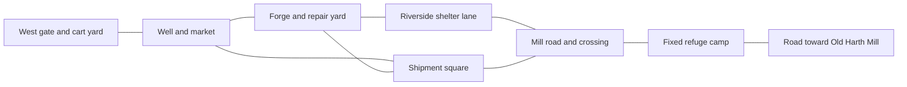

# Hearthmere opening build brief

November 5, 2026. First campaign implementation handoff. The assignment is a playable opening from hero selection through arrival at the refuge after the giant attack. It ends at the first foothold in the connected world. The [production roadmap](PRODUCTION_ROADMAP.md) sequences the work after this milestone.

The [decision record](DESIGN_DIRECTION.md) governs requirements. The [opening story draft](OPENING_HOUR.md) and [branching campaign](BRANCHING_CAMPAIGN.md) govern continuity. The route, interactions, scene lines, and retry details below are **provisional build instructions**. They can be used for the first graybox and reviewed in play.

> **World V2 override (2026-11-08):** This document remains authoritative for Hearthmere's playable **story beats, interactions, assets, outcomes and regression checks**, but its town map, routes, coordinates, bridge/river positions, encounter spacing and camera placements are now **reference blockout only**. The owner has explicitly approved a structural and cinematic redesign. Story anchors will be resolved by stable identities in [World Architecture V2](WORLD_V2_ARCHITECTURE.md); keep **new World V2** save/resume functional as specified by the [Phase 0 audit](WORLD_V2_PHASE0_AUDIT.md). Legacy Hearthmere saves do **not** need migration (D165). Do not force new geography to reproduce this document's earlier layout.

## Assignment

Hearthmere is the sole campaign entry. The player picks Brynhildr, Celestia, or Akatsuki and keeps that hero throughout. The hero screen shows **Start Hearthmere** for a new hero or **Continue Hearthmere** when the chosen hero has a local save. Use the original isometric follow camera during gameplay. Use authored shots for major reveals and return to the original view before the next damaging action.

Build the layout as one physically connected space. Reuse the current movement, combat, touch controls, and basic enemy behaviors. Start with existing rigs, prop stand-ins, and placeholder vocals with subtitles. Deliver the complete playable flow before replacing those stand-ins with final assets.

The lead-in should feel like a town going about its work. Its target is roughly 15–20 minutes on a first visit. Record actual playtime, including where players stop or rush, and revise the activities if the route feels thin. Let the player trigger the shipment scene at their own pace. The giant attack gives the player people to rescue and a way out. All three heroes survive, the giant survives, and the town is occupied in the aftermath. The trio is cooperating out of necessity by the end.

**Milestone boundary.** This handoff ends at the refuge and a visible road toward Old Harth Mill. The mill dungeon, playable occupation and liberation, giant rematch, awakening, crafting professions, general world streaming, offline downloads, and cloud sync belong to later work. Keep the previous prototypes as internal references and preserve their stored data.

## Walkable layout

The map shows connections and approximate orientation. Use existing movement speed and landscape touch framing to set scale. An uninterrupted walk between adjacent spaces should be short enough that the town can be learned in one visit.

| Space | Before the attack | During and after the attack |
| --- | --- | --- |
| West gate and cart yard | Entry and class-specific reason for visiting. A small covered waystation provides the first town return point. | The waystation remains reachable from the work yard by a marked service lane for retries during the attack. Refuge takes over as the return point once reached. |
| Well and market | Hear a supply dispute, meet Mara, and see residents use the well. The forge chimney and shipment crane give clear bearings. | Wreckage interrupts the public route. Keep the service lane readable from the active play area. |
| Forge and repair yard | Meet Rowan and help test the cart. Open a short connection toward the shelter during ordinary town life so the player learns it. | The work yard and its rear gate become the rescue route. The cart returns as a way to move an injured civilian. |
| Shipment square | Royal crew prepares to open a sealed shipment. The selected hero finishes their immediate business here. | First giant strike closes the direct road out. Small enemies are fightable. The square funnels the rescue toward the forge. |
| Riverside shelter lane | Quiet lane with a stone wall, red roof, and a view toward the mill road. | Sheltered staging point for civilians and a place to see the next giant windup before stepping out. |
| Crossing and refuge | The road reads as a physical continuation out of town. The opening objective stays in town. | The player clears the last exposed stretch, escorts the civilians past a bend, and reaches a discreet fixed camp outside royal control. Use the same streets and landmarks on future visits. |

## Playable sequence

The IDs are proposed stable content keys. Store them independently of display text. Each trigger runs once per campaign progression. A completed beat can be reconstructed from its saved facts after reload.

| Beat | Player action | Completion and next objective |
| --- | --- | --- |
| **HM01 · Arrive** | Walk through the cart yard. Inspect a class-specific point of interest and ask for directions to the shipment square. | Record the hero's initial lead. The gatekeeper points them toward Mara in the market. Optional observation barks reward a look around. |
| **HM02 · Meet Mara** | Approach the market dispute and speak to Mara once she settles who gets the next repair. Carry a small replacement part to her forge or pick it up at the forge if the player missed it in the market. | Record that the player met Mara. Her request leads to Rowan. Use one shared objective and short class-specific responses. |
| **HM03 · Help Rowan** | Brace the cart, then roll it a short distance over the yard threshold to test the repaired wheel. Walk with Rowan toward its ordinary use by the shelter lane. | Record that the cart works and Rowan has been introduced. Show a resident taking the load. Mara and Rowan's exchange establishes their relationship through an ordinary disagreement about the repair. |
| **HM04 · Reach the shipment** | Walk to the square. Inspect the shipment or speak to its crew according to the hero's immediate concern. Select the prompted interaction when ready. | Commit the shipment opening and the town's attack state. Play or skip the reveal. Hand control back in safe cover with the objective **Reach the stranded civilians**. |
| **HM05 · Clear the square** | Defeat the small enemies between the player and the stranded group, then rally the group with an interaction. The two other heroes arrive through useful actions and join as AI. | Record that the group has been rallied and both companions are active. Mark the work yard route. Civilians move between safe hold points. |
| **HM06 · Open the rear gate** | Pull wreckage off the work-yard gate with a shared interaction. Clear the small threat at the cart and help load the injured civilian. The companion covering the yard acts when the gate task begins. | Record the open gate and the loaded cart. Move the group to the shelter wall. The other two heroes carry out their support tasks without companion commands. |
| **HM07 · Cross the mill road** | Read a repeated giant windup from cover. Once the strike lands, traverse the exposed stretch and signal the group forward from the far hold point. Fight or dodge around the smaller enemies blocking the last bend. | Record the group safely beyond the exposed road. Allies move only after the player secures the route. Walk with the group to the refuge. |
| **HM08 · Account for survivors** | Check in with Mara at the refuge. Hear conflicting ideas about following the soldiers and keeping the survivors safe. A mill-route clue gives the trio a reason to work together again. | Set the refuge as the fixed return point. Record the opening complete, the giant alive, and Hearthmere occupied. The road toward the mill stays visible at the milestone boundary. |

### Hero differences

| Selected hero | Lead-in interest | AI jobs in the rescue |
| --- | --- | --- |
| Brynhildr | Recognize the Covenant seal and notice a guard cutting across an escort procedure. | Celestia finds a passable route behind the work yard. Akatsuki scouts the far hold point and signals when it is clear. |
| Celestia | Compare an unreliable town fixture with its maintenance record and inspect the delivery meant to support it. | Brynhildr holds the yard approach. Akatsuki scouts the far hold point and signals when it is clear. |
| Akatsuki | Follow a guarded courier tied to a missing-person lead and spot a mismatch on the manifest. | Brynhildr holds the yard approach. Celestia finds a passable route behind the work yard. |

The selected hero rallies the civilians, opens the gate, and secures the crossing with the same controls on each run. Distinct starter moves change how each hero handles the small enemies. Support choreography can use class-flavored animations, while all three player paths work with basic interactions, movement, and combat. Lock required actions to clear prerequisites. Recover stalled companions at the nearest safe support position. A companion pathing fault or temporary knockout must leave a viable route to the next required action.

### Giant encounter rules

- Use a repeated forelimb strike as the giant's signature in this blockout. Show a raised limb, an audible cue, a ground telegraph, impact, and a readable recovery window. Carry the same signature forward to the rematch design.
- The giant is an environmental attacker during the escape. Give it a recognizable silhouette and visible reach across the square. The player fights the smaller creatures and works around the giant's strikes. The HUD tracks the rescue objective.
- Stage the first strike in the reveal for scale. Start damaging strikes only when the camera has returned and the player can respond. Safe cover and civilian hold points have to remain safe during every hazard phase. Schedule active strikes around reachable player actions. Entering a hazard is a combat risk. Waiting, pausing, skipping, or losing browser focus cannot kill an escort or commit a story consequence.
- For the first implementation, the same civilian group arrives at refuge on every successful opening. Ordinary enemies can delay that outcome by defeating the player. The group waits safely at the last hold point when the route is blocked.

## First cinematic pass

| Shot | Action and sound | Player handoff |
| --- | --- | --- |
| Shipment seal | A worker looks toward the guard. Metal strains, the seal cracks, and a pulse travels through the cargo. Keep the cause legible without explaining the conspiracy. | Control remains paused in the scene. |
| Scale reveal | Frame the crane and rooftops against the giant's arm. The forelimb rise and sharp metallic groan establish its recognizable tell. The impact breaks the far road and shifts the crowd toward the work yard. | The strike that changes the route is a committed story event. |
| Grounded response | Frame the injured civilian and the open cover route. Sample line for Mara, “The work yard. Get them behind the wall.” | Set the camera back to isometric, show **Reach the stranded civilians**, then enable hazards after the first readable tell. Skipping yields the same positions, route damage, and objective. |

Use a short interactive exchange at the cart and a short refuge conversation. Draft line for Rowan at the repair, “Try it over the step. If it holds there, it holds all the way to the well.” Give voiced lines either temporary speech or expressive vocal sounds paired with readable subtitles. Store stable scene and line IDs and keep draft audio local. The scene must pause and skip cleanly with voice, music, captions, and the camera all following the same lifecycle. Final dialogue, hero designs, giant anatomy, score, and shot timing go through presentation review.

## Save and continuity rules

Use a versioned opening snapshot per hero, distinct from legacy campaign data. Save stable actor and location IDs. Keep the selected class and display name, active beat, last safe position and return point, current health and resources, relevant party and encounter state, and durable events in that snapshot. Validate loads against the schema. Treat a failed write as a failure the UI can surface. Keep the last valid snapshot available. The overall world save format can be designed around the events proven here.

| Event | Required result in this build |
| --- | --- |
| Normal exit, refresh, or phone backgrounding | Restore the same beat, location, party, and encounter state from the latest valid snapshot. Save at objective mutations and on movement/combat checkpoints. If the exact position is unsafe or unavailable on reload, resume at the nearest valid hold point for that beat. Restart a half-finished attack from a clear telegraph before damage can occur. |
| Quit or skip during the giant reveal | The attack state and changed terrain are already committed. Load at the safe **HM05** entry after an interrupted reveal. Play and skip must land at that same entry. The shipment trigger and setup cannot fire twice. |
| Defeat during the escape | Return to the town waystation and make the player walk back through the service lane. Preserve the attack state, introductions, opened gates, and any civilian group already secured beyond the crossing. Repopulate ordinary enemies on the active route. Reset the unresolved movement or combat to the last safe hold point, with no permanent civilian loss on defeat. |
| Refuge reached | Commit opening completion and the refuge return point once. Later episodes can read the town as occupied, the trio as formed, and the same giant as alive. Preserve Mara for her later story and Rowan alive with his whereabouts unresolved. Exact abduction staging remains open. |

Suggested durable events include `met_mara`, `cart_repaired`, `shipment_opened`, `trio_formed`, `yard_gate_opened`, `group_beyond_crossing`, and `refuge_reached`. The player reaching the next beat depends on the required gameplay completion, rather than on whether they watched every scene or spoke to an optional NPC. Later mission authors should have explicit facts to read for the giant, town, Mara, and Rowan.

## Implementation passes and evidence

1. **Playable blockout.** Wire Start and Continue. Build one continuous route with the three arrival variants, the cart interaction, the attack, the two AI support roles, and the refuge. Use existing render, audio, and combat systems where practical. Keep opening beats and state rules separate from the legacy chapter list.
2. **Persistence and failure pass.** Implement checkpoint writes, guarded progression, duplicate trigger prevention, scene completion and skip, and recovery from reload or defeat. Test the stable facts at each boundary, including isolation from existing saves.
3. **Presentation and device pass.** Stage the three reveal shots, repeatable giant attack, local vocal placeholders, and touch prompts. Capture a first-time playthrough and a frame-time trace during the market, first giant strike, and crossing. Verify the 60 fps target on a physical iPhone 14 Pro and test touch on an Android reference device when available. Report device, browser, build, and capture conditions. Desktop and emulation evidence can verify flow and layout.

### Acceptance checks

| Check | Pass condition |
| --- | --- |
| All three heroes | Reach the refuge on each run using the selected hero. Different leads resolve into the shared shipment interaction. AI does its part without taking control away from the player. |
| Connected travel and pacing | Walk through town and to the refuge without portal selection or chapter menus. Time an unhurried first visit and record where the 15–20-minute lead-in earns its time. |
| Rescue readability | A first-time player can find the civilians, read where the giant can hit, and recognize when to move. Touch players can move and use the required interactions without relying on keyboard shortcuts. |
| Cinematic handoff | Play, pause, skip, and reload the reveal. Every exit lands at the correct gameplay objective with the same town state and a readable hazard tell. |
| Save and defeat | Reload during town life, after the gate opens, while the giant telegraphs, and at the refuge. Test defeat before and after crossing. Check durable facts, enemy repopulation, continued route access, and legacy save isolation. |
| End state | The refuge is active and the mill road is visible. The town is occupied. The trio is together, the giant is alive, and the later Rowan and Mara branches are still available. |
| Build verification | `npm run build` and `npm test` pass. Report the runnable entry point, what was actually playtested, remaining placeholders, and physical-device results if measured. |
