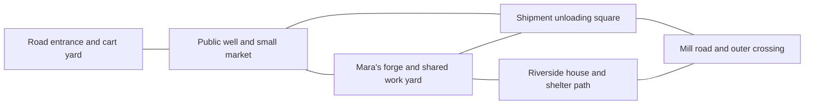

# Hearthmere — opening sequence draft

November 4, 2026. **Confirmed:** begin with a brief playable lead-in of roughly 15–20 minutes, meeting people and experiencing town life (D101), then survive an overwhelming giant attack, rescue civilians, and escape rather than defeat it (D102). Specific activities, dialogue, geography, creature design, and encounter stages below are proposals for review. This is a story/scene brief, not implemented quests or a finished encounter script.

Read the [branching campaign](BRANCHING_CAMPAIGN.md) for later consequences and the [presentation brief](NARRATIVE_PRESENTATION.md) for cinematic direction. Canonical hero names identify authored roles; the selected hero retains the player's chosen name and appearance.

## What the opening must earn

Hearthmere should become a place the player can recognize before it becomes a place to defend. Mara and Rowan need actions, needs, and a relationship beyond the loss coming later. The selected hero must feel capable at the beginning without already possessing the endgame's speed or transformations.

The tone is a tense working frontier town with a few moments of warmth. Avoid a festival, a parade of future victims, or a biography recital. Normal life includes overdue repairs, guarded roads, and uncertainty about royal supplies. The player need not understand the command network or Caedran's conspiracy yet.

## Proposed connected town space

Use a compact walkable arrangement that later combat and rebuilding can alter:

These are neighboring places, not portals. From the work yard, the player should see the unloading square and a recognizable roofline on the shelter path. Later, smoke, damaged cover, and people using those same paths make the crisis understandable without a new map tutorial. The mill road continues into the connected world.

## The playable lead-in

The following is a pacing estimate for a focused first visit, not a countdown. Exploration and reading can extend it. There is no hidden attack timer that punishes meeting people or pausing the browser.

| Approximate elapsed time | Proposed player action | Relationship and story purpose |
| --- | --- | --- |
| 0–3 minutes | Enter Hearthmere as the chosen hero, move through the cart yard, and orient toward the shipment square. | Establish one immediate personal reason for being here and the contrast between a living town and its military supervision. |
| 3–7 minutes | Cross the well/market area and meet Mara as she settles a practical disagreement about repairs and supplies. | She is already responsible for people. Her warmth is brief and specific, not instant friendship with a stranger. |
| 7–12 minutes | Help Rowan finish one small repair in the shared work yard while Mara handles another resident's problem. | Give Rowan competence and his own opinion about what the town needs. Let the siblings disagree and work together without explaining their entire history. |
| 12–17 minutes | Accompany the repaired equipment toward its ordinary use and see the shelter path and unloading square. | Show who benefits from their work. Rowan is a person helping a community, not only Mara's endangered brother. |
| 17–20 minutes | Resolve the selected hero's immediate business at the square. The shipment is opened as part of that scene. | Trigger the crisis through a legible event after the lead-in, not an invisible clock or an unrelated optional conversation. |

### One useful action, not a list of chores

Proposed shared activity: Rowan is repairing a damaged handcart used to move water containers and workshop supplies. The player helps position it and test the repaired wheel while he fits the part. Keep it to a short, direct interaction and a brief movement beat; do not require a mandatory crafting minigame, collecting five materials, or learning a profession first.

The little success should be visible when someone uses the cart. The same cart can later help carry supplies or an injured resident during the crisis. This recurrence gives an ordinary action meaning without making the town's survival depend on a hidden optional reward.

Exact utility unlock timing remains open. Do not assume that all three signature utilities, awakening, or advanced skill-tree techniques are available before the catastrophe. The shared lead-in must work with basic interactions for any selected hero.

### Different reasons, one living place

Retain the proposed motivations from the campaign draft, subject to review:

- **Brynhildr:** a military escort contract brings her to the shipment. She notices guards treating civilians as obstacles and recognizes professional procedure being bent.
- **Celestia:** an equipment inspection brings her to the failing civilian systems. She sees a mismatch between the town's maintenance records and what workers actually have.
- **Akatsuki:** a missing-person courier lead brings her to the incoming cargo. She notices a guarded movement or disputed manifest worth following.

The shared people and locations remain, but the opening concern, observations, and available dialogue reflect the chosen hero's history. Do not require three separate campaigns' worth of arrival content or give the selected hero knowledge belonging to another class.

The other two heroes can be glimpsed independently in the square, but they do not arrive as friends, banter as an established party, or solve the player's task. Their meaningful introductions come through the crisis. The player keeps the same hero throughout.

## Proposed transition into the crisis

Build unease from concrete things: a guard closes an ordinary approach, animals react to the sealed cargo, and someone tries to keep workers away from a damaged fitting. The final lead-in interaction places the selected hero where the shipment opening is understandable. Do not make accepting a help request a secret moral cause of the disaster; Caedran's operation is responsible.

A short cinematic can establish the broken seal, unnatural signal, and the first incoming threat, then return control promptly. The warm repair scene should not be followed by an exposition speech explaining the whole conspiracy. Let the player's next action be clear: reach people in immediate danger.

**Confirmed crisis (D102):** an overwhelming giant attacks. The three must survive, rescue civilians, and escape; they do not defeat it here. The crisis creates forced cooperation without granting the trio their late-game power or making them instant friends. Exact creature anatomy, combat interactions, and escape staging remain proposals.

## Survive the giant — proposed playable sequence

The giant is an immediate physical threat in the same town the player just crossed. A short reveal establishes its scale, then returns control to the selected hero. Communicate the objective as reaching people and opening an escape, not emptying a boss health bar. The following stages fit within the first-hour direction; they are not additional hours or confirmed numerical timings.

1. **The square breaks:** a limb or body impact destroys part of the unloading area and separates groups of civilians. Give the player a clear safe direction and one reachable rescue objective. Smaller hostile creatures create combat the grounded hero can actually win. The other heroes enter through useful actions in different parts of the same emergency, with no prior friendship assumed.
2. **Open a way through the work yard:** move people from the square toward the previously seen forge/shelter path. Proposed obstacles include a jammed gate and wreckage exposed to the giant's next attack. The selected hero handles the active task while companions handle understood supporting roles; do not require unconfirmed signature-utility unlocks. Camera framing, sound, and visible wind-up communicate where the giant will strike.
3. **Create a brief opening:** let the company interrupt a local threat or make the creature recoil long enough to move the next group. Exact stagger/damage interactions need design. This buys space, not a secretly winnable giant fight. Do not let the player spend ten minutes reducing an apparent boss health bar only to cut away and announce defeat.
4. **Get people beyond its reach:** cross the shelter route while the giant remains active behind or alongside it. Use cover, short movement windows, and targeted combat rather than an uninterrupted automatic sprint. A brief cinematic may show a changed route or a major impact; the player still performs the selected hero's escape and rescue actions.
5. **Reach a defensible refuge:** finish the sequence with people to account for, injuries and damage to understand, and a reason for the strangers to cooperate on what comes next. The giant has not been killed. Its exact departure or containment and the royal troops' cover-up remain to be authored. Hearthmere is occupied afterward (D106); this refuge cannot silently make the occupied center an openly welcoming safe hub.

### Agency and fair constraints

Rescue progress must come from reachable, readable actions, not a film of the selected hero saving everyone. Allow the player to fight smaller threats, help a specific person, and open a usable path. The overall retreat can be unavoidable while those actions remain meaningful. This answer does not approve a new forced supporting-character death, a particular civilian casualty count, or a hidden timer deciding who survives.

The giant's overwhelming scale must be established through its behavior and the heroes' actual capabilities. Do not silently disable an existing dodge or ability to force a capture. If a giant interaction is safe only during a particular opening, communicate that through the encounter. Exact combat tuning and recovery from missed rescue actions remain open; the Compact finale's special recovery rule is not automatically a rule for this opening.

Use the original isometric view during play. Brief cinematic views can reveal scale, but off-screen impacts still need readable cues when control returns. Do not hide a damaging strike behind an uninterruptible camera pan. Pausing, skipping a cinematic, or returning from a browser interruption cannot advance an unseen rescue-failure clock.

The catastrophe creates awakening potential without unlocking the full forms during this escape. All three first awaken later during Hearthmere's giant rematch, turning that battle (D113–D114). Utility unlock timing also remains open, so prototype the escape with basic movement/combat and authored environmental interactions before relying on any new traversal power. The same rescue progression must work for warrior, mage, and assassin with two AI companions.

The mill road and connected world remain physical places. This escape is a local emergency, not a new portal-based chapter transition. Defeat still follows the established town/fixed-camp policy; the opening's first valid return location and unresolved-encounter handling need explicit design. Stopping and resuming remains separate from defeat.

## First-hour direction after the lead-in

These are provisional beats, not a fixed hour-long timed mission:

- **The first response:** the overwhelming giant forces rescue and escape rather than a kill objective (D102). Give the selected hero an immediate combat or rescue task. Introduce the other two through useful actions that reveal different instincts. Player control stays with the selected hero, and AI role behavior respects objectives and prerequisites.
- **The conflict behind the attack:** royal troops prioritize the shipment and evidence over civilian safety. Show the contradiction through orders and action before explaining its full meaning. The exact betrayal scene still needs review.
- **An imperfect shared effort:** the three cooperate because the immediate problem requires it. They can disagree about pursuit, cover, or evacuation; trust is not instantly complete.
- **People accounted for:** preserve Rowan's later reservoir branch. If the proposed opening abduction remains, establish that he was taken alive; do not allow a random opening enemy or escort fault to kill him before C02. Mara survives this draft's opening; no new forced death is approved here.
- **A reason to continue:** end the opening operation with a concrete lead toward the mill/prison route and a town whose people still have needs. Do not compress the full four-hour opening movement, mill dungeon, and first major alliance into the first hour.

Ordinary movement, observation, and fighting remain the main activity. Use short cinematic turns to connect events, not to play the selected hero's important actions while the player watches. All cinematics retain the confirmed pause/skip support.

## Presentation and later continuity

**Confirmed town arc (D106):** after this attack, Hearthmere is occupied. The trio works covertly with residents, must liberate the town, and later returns to defend it in the giant rematch. The [branching campaign](BRANCHING_CAMPAIGN.md) proposes occupation and liberation development. Initial shelter is discreet or outside the occupied center; the familiar streets remain physical places with changed access. The liberation is now a covert operation that dismantles garrison control and removes leadership before a full response (D107). Exposure before leadership is isolated continues into harder combat with changed objectives, while liberation remains achievable (D108). Exact objectives, escalation tasks, timing, and the interval before the siege remain open.

Strong cel-shaded silhouettes, readable expressions, directional light, and carefully framed ordinary gestures should establish cinematic quality before large effects. Proposed recurring visual details include forge light on the siblings' faces and the repaired wheel passing the same threshold before and after the attack. These are scene concepts, not asset specifications or completed art.

Keep touch camera assistance and readable nearby objectives central. Spectacle cannot rely on a distant overhead view or untelegraphed attacks hidden by crowds. Crowd density, effects, lighting, and asset loading need later device budgets and physical iPhone 14 Pro validation; the 60 fps requirement is not verified by this brief.

Record which people were met and relevant actions without making skipped optional chats hidden ending requirements. The lead-in must establish enough of Mara and Rowan on the required path for either reservoir outcome to land. Mara's later trust branch (D99–D100) grows from these relationships; the opening does not preselect reconciliation or estrangement.

The eventual encounter brief must specify start/stop persistence, defeat return behavior, the shipment trigger, AI participation, and state transitions. No code, voice, models, animations, or save migration has been implemented here.

## Later payoff — the same giant, a changed company

**Confirmed (D103–D105):** the opening giant returns during Hearthmere's defense, where the trio kills it with a spectacular, earned finisher while protecting the same town and people. The rematch is on the shared main-story path and occurs under either siege authority approach. Exact boss mechanics and choreography remain proposals.

### Proposed encounter contrast

| Opening survival | Later rematch proposal |
| --- | --- |
| A recognizable attack forces retreat behind cover. | The same recognizable wind-up becomes an opening the player can deliberately evade and counter. |
| The strangers create enough room to move a few civilians. | The company coordinates a sustained assault while allies carry out an understood civilian-safety plan. |
| Local interruptions only buy time to escape. | Those familiar physical features now lead into meaningful phases and a winnable confrontation. |
| The player sees power they cannot yet match. | The player uses techniques and teamwork developed during the actual campaign, then their newly unlocked awakened forms as the battle turns (D114). |

Identify the individual through consistent silhouette, movement, and a distinctive visible feature established in the opening. Exact anatomy and any scars or damaged equipment are design proposals; do not require the player to have completed an optional opening interaction to recognize it.

The shared first awakening is now confirmed as the rematch's turning point (D114), on both authority paths. Begin with developed normal techniques, then return to substantial playable awakened combat before the killing finisher. Complete earned mutual trust is the confirmed emotional catalyst (D115): they combine learned mastery instead of fighting as individuals. Exact actions, dialogue, phases, and activation staging remain proposals. The rematch should feel like a different operation, not the escape map replayed with a health bar. Proposed phases change positioning, expose different local targets, and let the player turn remembered danger into opportunity. Most of the encounter remains playable; short transitions and a spectacular finisher provide punctuation. Do not make a cutscene, a passive artillery crew, or an automatic new power deliver the whole victory.

Every playable hero needs an effective role without switching characters. The two AI companions handle their own actions and understood team dependencies. The exact utility interactions must match abilities actually unlocked at the chosen campaign point. Preserve the contained power scale: precise, superhuman action against a gigantic enemy rather than destroying the surrounding region.

### Confirmed placement and continuity

The Hearthmere siege, C05, is the confirmed placement (D104). Its siege beast is the same individual. Recognizable streets and people give the rematch a personal purpose: the trio can now defend the place it once had to escape. The [branching campaign](BRANCHING_CAMPAIGN.md) proposes different support and battlefield approaches for civilian coordination and emergency command, with the same earned defeat of the giant.

Plan the rematch within the main-story encounter inventory and time budget rather than adding a new chapter by default. The opening escape does not count as killing a named boss. The rematch now confirms its death (D105); preserve that outcome through player defeat, travel, and the continuing world. Do not respawn the same individual as an ordinary hunt or bring it back as a later surprise phase.

### Earned finisher — proposed presentation

After the player completes the decisive combat stage, give the selected hero the central contribution to a short coordinated finishing action. The two companions help create the opening and secure the immediate space; the chosen hero does not become a spectator to another class's cinematic. Adapt the choreography for warrior, mage, and assassin while keeping the giant's death and the story outcome consistent.

Recall a movement or threat from the opening escape, then show the company overcoming it through speed, precision, and trust. Strong posing, brief impact emphasis, and a clear killing action can deliver the anime spectacle without destroying the surrounding district. Use only powers earned by this point; an uncharged or locked awakening is not silently granted to justify the shot. Exact activation/input, animation, effects, and duration remain to be designed. Pause/skip support remains required.

Give the aftermath space to register that the threat is truly over. The company can share relief and the townspeople can respond according to actual relationships. This does not erase Rowan's fate, make an estranged Mara personally reconcile, or end emergency military authority automatically. The finisher establishes victory over this creature, not a clean slate for the campaign.
